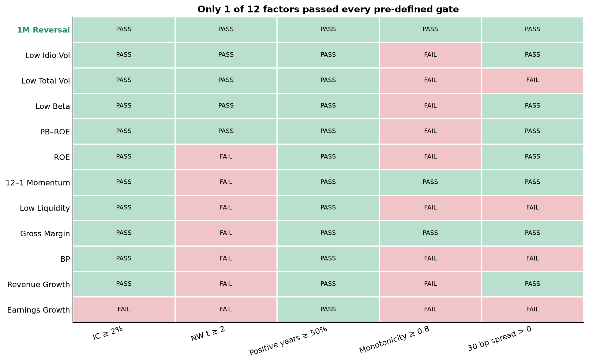
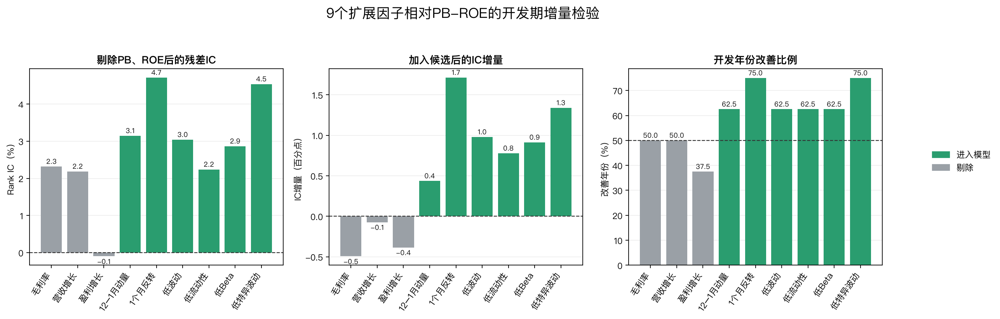

# 12因子评价、PB-ROE增量检验与筛选报告

## 1. 这一阶段解决什么问题

Commit06按顺序回答三个问题，而不是为了凑固定数量的因子：

1. **独立评价**：12个因子单独排序时，IC、显著性、五分组单调性和成本后收益怎样？
2. **与PB-ROE的逻辑关系**：扩展因子是否提供PB、ROE之外的新信息，并能改善PB-ROE基线？
3. **模型输入资格**：哪些因子可以进入同一Elastic Net / LightGBM输入清单？

严格独立评价仍只有1个月反转通过，但这不是模型输入门槛。模型层固定保留构成PB-ROE的BP与ROE，再从9个扩展候选中选出6个真正提供开发期增量的因子，最终manifest为8个特征。

机器结果见[`factor_validation_summary.csv`](results/factor_validation_summary.csv)、[`factor_incremental_analysis.csv`](results/factor_incremental_analysis.csv)、[`model_factor_eligibility.csv`](results/model_factor_eligibility.csv)和[`model_feature_manifest.json`](results/model_feature_manifest.json)。每个因子的IC与五分组图位于[`results/figures/factor-analysis-12/`](results/figures/factor-analysis-12/)。

## 2. 时间与统一预处理

| 时间 | 用途 | 是否参与筛选 |
|---|---|---:|
| 2010-01至2012-04 | 为动量、Beta和波动率积累历史；PB/ROE覆盖尚未连续达标 | 否 |
| 2012-05至2014-12 | 现代PB-ROE描述性评价 | 否 |
| 2015-01至2022-12 | 12因子独立评价、PB-ROE增量检验和资格冻结，共96个月 | 是 |
| 2023-01至2025-10完整标签月 | 旧严格反转的预留检验；新版8因子方案只能作探索性历史检验 | 否 |

每个信号日只使用当时已公开财务信息和当时有效的沪深300成员。截面先做1%/99%分位缩尾，再做z-score；当前实现不是MAD去极值。低波动、低Beta、低流动性和低特异波动预先乘以-1，因此所有方向调整后的分数均为“越高越看多”。下一持有期收益只作为标签，不进入当期预处理。

五分组单调性检查Q1至Q5五个组合的**平均收益**能否随因子分数总体上升；不要求同一组内每只股票的未来收益也排序，因为组内个股仍有大量特质噪声。

## 3. 12个因子的公式、市场规律与限制

| 因子 | 工程定义 | 预期规律与生效逻辑 | 主要限制 |
|---|---|---|---|
| BP | `book_equity / market_value = 1/PB` | 便宜股票获得价值回归或风险补偿 | 价值陷阱、账面价值滞后 |
| PB-ROE | 标准化BP与ROE方向一致组合 | 质量过滤低估值中的基本面恶化公司 | 是BP和ROE派生分数，不能与二者重复当成独立输入 |
| ROE | TTM净利润 / 平均净资产 | 高资本效率与盈利持续性 | 杠杆、周期峰值、低净资产会机械抬高ROE |
| 毛利率 | 毛利润 / 营业收入 | 定价权和产品差异化可能持续 | 行业差异大，缺少PIT行业分类 |
| 营收增长 | 营业收入同比增长 | 需求扩张与规模增长可能延续 | 低基数、增长已被定价 |
| 盈利增长 | 净利润同比增长 | 盈利上修和经营杠杆 | 非经常损益、周期和低基数 |
| 12–1月动量 | 过去12个月收益剔除最近1个月 | 信息扩散缓慢使中期赢家延续 | 拥挤、状态切换、动量崩溃 |
| 1个月反转 | 最近1个月收益取反 | 短期流动性冲击或过度反应回补 | 高换手、成本敏感、趋势期失效 |
| 60日波动率 | 60日日收益标准差取反 | 彩票偏好和杠杆约束形成低波异常 | 防御行业暴露，与特异波动相关 |
| 20日流动性 | 20日成交活跃度指标取反 | 较难交易股票获得流动性补偿 | 冲击成本和容量难完整模拟 |
| 252日Beta | 对等权市场的滚动Beta取反 | 杠杆约束使高Beta被过度追捧 | Beta时变且依赖市场代理与窗口 |
| 特异波动率 | 市场模型残差波动率取反 | 彩票偏好可能压低高特异波动未来收益 | 残差模型简化，与总波动可能冗余 |

这些只是常见Value、Quality、Growth、Momentum、Risk & Trading风格因子；本工程没有使用MSCI Barra商业因子定义，也不是完整Barra风险模型。

## 4. 独立因子评价结果

预设严格门槛为：开发期Rank IC不低于2%、Newey-West t不低于2、正IC年份不少于50%、五分组单调性不低于0.80、30bp成本后多空年化为正。

| 因子 | 开发IC | NW t | 正IC年份 | 单调性 | 30bp多空年化 | 2023–2025 IC | 严格结论 |
|---|---:|---:|---:|---:|---:|---:|---|
| 盈利增长 | 1.09% | 0.80 | 62.5% | 0.60 | -0.32% | -0.41% | 失败 |
| 营收增长 | 2.01% | 1.30 | 62.5% | 0.70 | 3.76% | -3.48% | 失败 |
| 12–1月动量 | 2.94% | 1.39 | 75.0% | 1.00 | 6.23% | 3.79% | t值不足 |
| 1个月反转 | 4.47% | 2.29 | 75.0% | 1.00 | 5.92% | -1.89% | 开发期唯一通过，后段失效 |
| 毛利率 | 2.23% | 1.45 | 75.0% | 0.80 | 0.99% | -2.66% | t值不足 |
| ROE | 3.28% | 1.74 | 75.0% | 0.70 | 0.46% | -1.62% | t值、单调性失败 |
| 低Beta | 4.90% | 2.06 | 62.5% | 0.60 | 0.38% | 6.89% | 单调性失败 |
| 低特异波动 | 5.76% | 3.00 | 75.0% | 0.70 | 3.45% | 11.88% | 单调性失败 |
| 低流动性 | 2.72% | 1.71 | 62.5% | 0.30 | -1.97% | 4.11% | t值、单调性、成本失败 |
| 低总波动 | 5.21% | 2.84 | 75.0% | 0.10 | -2.96% | 12.03% | 单调性、成本失败 |
| BP | 2.18% | 0.89 | 75.0% | -0.20 | -5.04% | 9.36% | t值、单调性、成本失败 |
| PB-ROE | 4.32% | 2.17 | 75.0% | 0.20 | 0.45% | 7.22% | 单调性失败 |

这个结果回答“能否单独交易”。它不能直接推出“其余因子对多因子模型完全无用”，也不能因为后段表现更好就回头替换严格名单。

## 5. 从PB-ROE诊断到扩展因子：2到3的桥梁

现代PB-ROE开发期IC为4.32%，但五分组单调性只有0.20，30bp后多空年化仅0.45%。因此扩展因子的目标不是另起炉灶，而是弥补PB-ROE的单一价值质量维度和弱交易表现。

对9个扩展候选，开发期固定执行：

1. 按预设经济方向调整符号；
2. 每月用截面回归`candidate ~ BP + ROE`，用残差与下一期收益计算Rank IC，确认存在PB、ROE解释不了的信息；
3. 构造`Add-one = 2/3 × PB-ROE + 1/3 × candidate`；
4. 比较Add-one IC与PB-ROE IC，并统计8个开发年份中改善的比例；
5. 同时要求月均绝对相关低于0.85以及数据、方向、覆盖和非冗余资格通过。

冻结门槛为：残差IC大于0、Add-one IC增量大于0、至少50%的开发年份改善。门槛在正式重跑前写入配置，结果出来后未调整。

| 扩展因子 | 与PB-ROE绝对相关 | 残差IC | Add-one IC | IC增量 | 改善年份 | 结论 |
|---|---:|---:|---:|---:|---:|---|
| 毛利率 | 0.033 | 2.32% | 3.82% | -0.49个百分点 | 50.0% | 剔除：降低基线IC |
| 营收增长 | 0.079 | 2.19% | 4.24% | -0.07个百分点 | 50.0% | 剔除：降低基线IC |
| 盈利增长 | 0.107 | -0.10% | 3.93% | -0.38个百分点 | 37.5% | 剔除：三项失败 |
| 12–1月动量 | 0.147 | 3.15% | 4.75% | +0.44个百分点 | 62.5% | 进入模型 |
| 1个月反转 | 0.176 | 4.71% | 6.03% | +1.71个百分点 | 75.0% | 进入模型 |
| 低总波动 | 0.412 | 3.04% | 5.30% | +0.98个百分点 | 62.5% | 进入模型 |
| 低流动性 | 0.120 | 2.24% | 5.09% | +0.78个百分点 | 62.5% | 进入模型 |
| 低Beta | 0.384 | 2.87% | 5.23% | +0.91个百分点 | 62.5% | 进入模型 |
| 低特异波动 | 0.381 | 4.54% | 5.65% | +1.34个百分点 | 75.0% | 进入模型 |

低总波动和低Beta的Add-one多空收益并不为正，但它们仍通过模型输入资格，因为这一层检验的是**相对PB-ROE的预测信息**，不是再次要求候选独立可交易。它们是否最终有用，由等权基准和walk-forward模型共同接受后续检验。

## 6. 最终模型manifest与筛选原因

最终8个输入是：

- 核心结构：`bp_z`、`roe_z`；
- 增量扩展：`momentum_12_1_z`、`reversal_1m_z`、`volatility_60d_z`、`liquidity_20d_z`、`beta_252d_z`、`idiosyncratic_volatility_z`。

`paper_score_z`是比较基线，不进入模型，因为与BP、ROE同时输入会重复计算。毛利率、营收增长和盈利增长没有证明相对PB-ROE的Add-one增量，因此剔除。最大保留因子相关为总波动与特异波动0.733，低于0.85冗余阈值。

最终并不是“符合严格要求的反转因子不用了”：反转既保留独立失败/成功证据，也因通过增量检验进入模型。严格名单回答独立交易问题；8因子manifest回答组合建模问题；两个结论同时成立。
