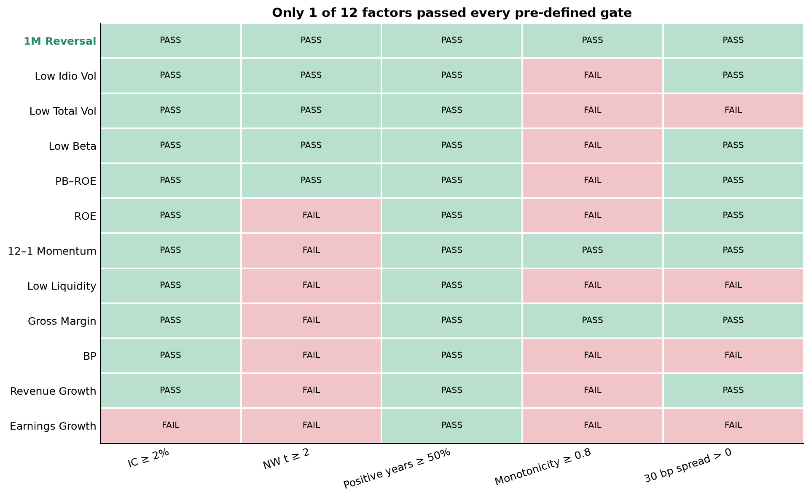
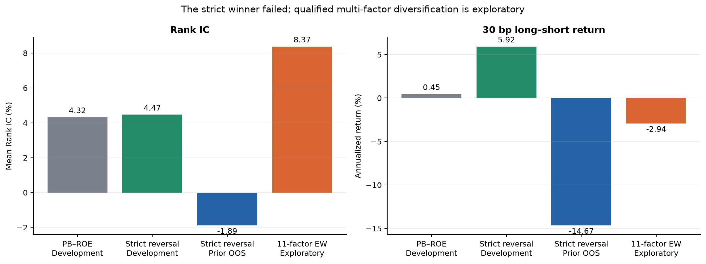

# PB-ROE策略复现、评价与现代多因子改进

## 工程流程：从原方法到可证伪的改进

```text
华泰2011年PB-ROE研报
  │
  ├─ 1. 原文规则复现（2005–2011，18个持有期）
  │     目标：原方法能否在免费数据中方向性复现？
  │     输出：ROE、PB、PB-ROE及行业版本与原文对照
  │
  ├─ 2. 现代PB-ROE再评价（2012–2025，月频）
  │     目标：历史规律在PIT与现代交易口径下是否还存在？
  │     输出：IC、五分组、成本后多空和静态行业诊断
  │
  └─ 3. 现代多因子改进（沪深300历史成分）
        12候选因子
          ├─ 严格独立有效性 → 唯一胜者：1个月反转 → 后续预留检验失败
          └─ 模型输入资格 → 11个原始因子合格，排除派生PB-ROE重复项
               ├─ 11因子方向等权：简单多因子基准
               ├─ Elastic Net：可解释线性主模型
               └─ LightGBM：唯一非线性挑战模型
                    ↓
               同一walk-forward与同一组合约束
                    ↓
               比较IC、收益、Sharpe、回撤、换手与成本
```

这条主线不是“原文复现”和“现代模型”两项无关工作。现代层从PB-ROE的历史结论出发，先检验它是否仍有效，再把价值、质量、增长、动量和风险交易指标纳入统一流程，最后判断复杂模型是否比简单分散真正增加价值。

## 摘要

本项目方向性复现了华泰证券2011年《PB-ROE策略》的2005–2011完整18期规则，并建立了一个带point-in-time财务时点、历史沪深300成分、12因子验证、walk-forward模型和风险约束组合的业界研究MVP。

原文层中，PB-ROE Top50成本后年化为29.86%，原文为35.00%；18期中12期跑赢成分等权代理，说明历史方向和量级可以基本复现，但“行业等权版本最佳”没有复现。

现代层中，PB-ROE全期Rank IC为5.13%，高于BP的4.56%与ROE的1.78%，但30bp后多空年化只有2.78%，五组单调性不足。12因子严格筛选在2015–2022只选出1个月反转，它在预先保留的2023–2025区间IC由4.47%变为-1.89%，因此独立因子改进失败。

随后采用更符合业界MVP的“模型输入资格”：11个原始因子通过PIT、覆盖率、方向和冗余审计；PB-ROE派生分数不与BP、ROE重复输入。2023–2025探索性历史检验中，11因子方向等权IC为8.37%，30bp组合年化9.76%、Sharpe 0.54、最大回撤-12.29%，高于5.58%的等权基准。Elastic Net和LightGBM的IC分别为1.93%和3.58%，组合年化为1.85%和5.24%，均未优于简单等权。

因此最准确的结论是：**多因子分散显示出价值，但机器学习没有证明相对简单等权的增量；由于新版方案是在查看2023–2025后形成，其正结果只能称为探索性，必须等待新增月份做真正前瞻检验。**

## 1. 研究问题与成功标准

项目依次回答：原研报能否复现；PB-ROE在现代口径下是否有效；12个候选中哪些能独立成立；哪些可以作为模型输入；Elastic Net或LightGBM能否击败简单等权；成本和约束后是否超过基准。

成功不是“必须跑赢”，而是规则可执行、数据无明显前视、证据状态清楚、每层有对照、负结果不被删除、结果能由同一配置重跑并审计。

## 2. 时间框架：每段数据到底做什么

### 2.1 两条历史线不能拼成一条

```text
原文复现线： 2005 ───────────────────── 2011-03-25
              18个正式持有期，直接计算策略收益

现代改进线： 2010 ── 2012-05 ── 2015 ───────── 2023 ── 2025
              价格热身   现代评价    开发/资格/滚动训练   历史检验
```

原文复现有完整回测。现代数据从2010开始，不代表2010就生成正式现代结论：12–1月动量需要约一年行情，Beta和特异波动需要252个交易日；同时PB和ROE直到2012-05才连续达到覆盖门槛。2010–2012初的行情只是让第一批正式月拥有足够过去数据，并没有被当成收益成绩。

| 区间 | 目标 | 方法 | 是否输出正式结论 |
|---|---|---|---|
| 2005Q1–2011-03-25 | 原研报规则复现 | 每年4/30、8/31、10/31调仓，共18期 | 是，原文层 |
| 2010-01–2012-04 | 现代滚动特征热身 | 积累一年动量、Beta和波动率历史 | 否 |
| 2012-05–2014-12 | 现代PB-ROE评价准备 | 覆盖率达标后计算月频IC和分组 | 只作现代描述，不选12因子 |
| 2015-01–2022-12 | 统一开发期 | 严格因子门槛、模型资格、逐月walk-forward | 是，开发证据 |
| 2023-01–2025-10完整标签 | 后段历史检验 | 不把当月未来收益放入训练 | 严格反转为预留检验；新版模型为探索性 |
| 本版冻结后的新增月份 | 真正前瞻检验 | 不改manifest与参数，只追加数据 | 未来才能形成 |

### 2.2 Walk-forward的防泄漏逻辑

预测月份为T时，程序只保留信号早于T且持有期退出日不晚于T的成熟标签；训练窗最长60个月、最少24个月。Elastic Net使用完整成熟窗。LightGBM把更早月份用于拟合，把最后12个成熟月份按时间顺序用于early stopping，绝不随机打乱。随后只预测T月横截面，并在下一交易日开盘形成组合。

所以这里有两个概念：代码上的“无未来标签”是数据因果性；研究上的“是否真正样本外”取决于研究者在定规则前是否看过该区间。新版11因子方案是在旧结果暴露后修订的，因此即使代码无泄漏，2023–2025也必须降级为探索性。


## 3. 数据与审计

### 目标

让每个信号只使用当时能看到的信息，并防止用今天的股票池或行业标签重写历史。

### 方法

历史沪深300成员按有效区间拼接；790只只是研究窗口内曾进入过沪深300的证券并集，不是中证800。现代财务首次可见日使用Eastmoney `NOTICE_DATE`，不再误把后续`UPDATE_DATE`当首次公告。canonical输入保存文件哈希和配置指纹。静态BaoStock行业快照不进入正式历史标签或组合约束。

### 结果

正式现代数据审计通过17项检查；ROE公告滞后中位数39天、95分位119天。原文层覆盖2005–2011完整18期。现代模型特征manifest记录配置指纹`e1a9997cc505fc26`和canonical输入manifest哈希。

### 分析与限制

免费数据不能逐值复制Wind历史快照；2005–2006早期ROE按统一披露完成日生效；缺少PIT行业分类、真实历史指数权重和完整退市持仓账本。因此可以称规则复现和研究MVP，不能称Wind逐值复刻或可直接实盘。

## 4. 原研报复现

### 目标

检验低PB、高ROE与二者综合排序在原窗口是否具有与研报一致的方向和量级。

### 方法

调仓日使用当时沪深300成员和可获得的最新财务报告；按原文构建ROE Top20、PB 50–100、PB-ROE Top50与两个行业版本；应用原文初始0.6%、后续1.3%的成本假设。

### 结果

| 策略 | 原文年化 | 本项目年化 | 本项目跑赢等权期数 |
|---|---:|---:|---:|
| ROE Top20 | 33.93% | 25.27% | 10/18 |
| PB 50–100 | 33.87% | 29.27% | 10/18 |
| PB-ROE Top50 | 35.00% | 29.86% | 12/18 |
| PB-ROE行业等权 | 36.47% | 28.00% | 13/18 |
| PB-ROE行业基准权重 | 34.04% | 28.51% | 14/18 |
| 沪深300成分等权代理 | — | 28.98% | — |


### 结果分析

PB-ROE Top50的方向与量级基本复现，但只比等权代理高约0.88个百分点；行业等权不是本数据中的最佳版本。差异可能来自Wind字段、行业分类、复权和早期ROE时点，现有证据不能推导原研报造假。

## 5. 现代PB-ROE评价

### 目标

把历史策略放进统一的现代月频、PIT与成本框架，判断价值质量逻辑是否仍有预测力和可交易性。

### 方法

使用BP、ROE TTM和二者方向一致的综合分；每月1%/99%缩尾、z-score，计算下一持有期Rank IC、Newey–West t、五分组和10/30/50bp多空收益。静态行业调整只作敏感性诊断。

### 结果

| 因子 | 全期IC | NW t | 五组单调性 | 30bp多空年化 |
|---|---:|---:|---:|---:|
| BP | 4.56% | 2.50 | 0.60 | 0.92% |
| ROE | 1.78% | 1.22 | 0.90 | -0.03% |
| PB-ROE | 5.13% | 3.73 | 0.70 | 2.78% |


### 结果分析

PB-ROE比单独BP和ROE的排序信息更强，支持价值与质量互补；但收益不够单调，成本后经济幅度远弱于原研报时期。静态行业调整后的结果看似改善，但由于行业标签不是PIT，不能当作因果主结论。

## 6. 12因子严格验证

### 目标

在不预设通过数量的情况下，找出能够独立构成策略的因子。

### 方法

候选包括价值、质量、增长、动量和风险交易12项。2015–2022同时要求IC≥2%、NW t≥2、正IC年份≥50%、五组单调性≥0.80、30bp后多空收益为正。

### 结果

只有1个月反转通过：开发IC 4.47%、t值2.29、单调性1.00、30bp多空年化5.92%。但其预先保留区间IC为-1.89%、t值-0.59，优化组合年化-4.84%。



### 结果分析

严格筛选没有保证未来稳定性。不能因为看见后段BP或低波动表现更好就倒推替换名单，否则会把检验期重新变成开发期。完整定义、市场规律、生效逻辑、限制和逐因子图见[`factor_analysis_report.md`](factor_analysis_report.md)。

## 7. 模型输入资格与简单多因子基准

### 目标

避免把“不能独立交易”等同于“对模型毫无信息”，同时控制垃圾特征、方向错误和重复特征。

### 方法

资格层检查PIT、有效月份、截面覆盖、不同取值、预设方向冲突和开发期相关性。平均绝对相关达到0.85时只留预先登记代表；PB-ROE作为BP和ROE的派生分数被排除。

### 结果

11个原始因子合格；最大相关为总波动与特异波动0.733，未触发冗余删除。方向调整后简单等权开发IC为8.27%，2023–2025探索性IC为8.37%、t值2.00。



### 结果分析

结果说明多个弱信号的分散可能比追求单个完美因子更有效。这不是废弃严格筛选：严格层仍负责评价独立策略并保存失败证据；资格层服务于多因子建模。两种输出回答的是不同问题。

## 8. Elastic Net与LightGBM

### 目标

用同一11因子输入检验动态线性权重或非线性交互是否比简单方向等权更稳定。

### 方法

Elastic Net是同时带L1与L2正则的线性回归，可收缩不稳定系数；LightGBM是唯一树模型，用时间验证窗早停。两者共享manifest、walk-forward标签隔离和预测月份。

### 结果

| 方法 | 开发IC | 2023–2025探索IC | 探索NW t |
|---|---:|---:|---:|
| 11因子方向等权 | 8.27% | **8.37%** | **2.00** |
| Elastic Net | 5.29% | 1.93% | 0.54 |
| LightGBM | 3.90% | 3.58% | 1.27 |


### 结果分析

LightGBM好于Elastic Net，但两者都低于等权。月频训练月份有限、关系时变，估计滚动系数与树阈值引入的方差超过其收益。保留两个模型仍有意义：它们证明复杂度没有增量，而不是让项目止于主观猜测。

## 9. 风险约束组合

### 目标

检验预测IC能否转为成本后的可执行长仓组合，并比较收益、Sharpe、回撤和换手。

### 方法

同一优化器要求满仓、非负、单票≤3%、漂移后月换手≤30%，使用历史收益风险矩阵和10/30/50bp成本。四条信号均使用同一股票池与约束。

### 结果

| 2023–2025探索性历史检验，30bp | 年化 | Sharpe | 最大回撤 | 月均换手 |
|---|---:|---:|---:|---:|
| 沪深300成分等权代理 | 5.58% | 0.20 | -21.51% | — |
| 严格反转 | -4.84% | -0.13 | -38.71% | 30.00% |
| 11因子等权 | **9.76%** | **0.54** | **-12.29%** | 24.44% |
| Elastic Net | 1.85% | 0.08 | -20.56% | 30.00% |
| LightGBM | 5.24% | 0.16 | -27.70% | 30.00% |


### 结果分析

11因子等权在收益、Sharpe和回撤上最好，50bp成本下年化仍为9.12%。Elastic Net明显落后，LightGBM复利年化略低于基准且回撤更大。组合优化无法救回负或不稳定的预测，但可以把稳定的分散信号转成更低回撤的持仓。完整成本与归因见[`portfolio_analysis_report.md`](portfolio_analysis_report.md)。

## 10. 总结：什么成立，什么没有成立

| 问题 | 结果 | 结论强度 |
|---|---|---|
| 原PB-ROE历史规律能否复现？ | 29.86% vs原文35.00%，12/18期胜基准 | 方向性复现 |
| 行业等权是否最佳？ | 本项目27.996%，不是最佳 | 未复现 |
| 现代PB-ROE是否仍有信息？ | IC 5.13%，但30bp年化2.78%、单调性0.70 | 有排序信息，经济性较弱 |
| 是否找到独立稳健因子？ | 反转开发期通过，预留IC -1.89% | 失败 |
| 合格多因子是否值得研究？ | 11因子等权探索IC 8.37%、组合9.76% | 有希望，但仅探索性 |
| Elastic Net是否增量？ | IC 1.93%、组合1.85% | 否 |
| LightGBM是否增量？ | IC 3.58%、组合5.24%，低于等权 | 否 |

项目最终不是“树模型战胜市场”，而是一个更接近真实业界研究的结论：历史效应可以方向性复现；严格单因子没有跨期稳定；合格弱因子的简单分散值得继续；复杂模型没有证明增量；证据标签必须跟着研究过程变化。

## 11. 局限与下一步

1. 冻结当前代码、manifest与参数，用新增月份做真正前瞻检验；
2. 若扩展因子池，只加入有独立经济来源的数据，如分析师预期、盈利修正或更可靠的质量指标，不能只换名字重复现有风格；
3. 取得PIT行业分类、历史指数权重和总市值后，新开版本检验行业/市值中性和基准跟踪误差；
4. 建立更完整的停牌、退市、涨跌停和冲击成本持仓账本；
5. 只有当Elastic Net或LightGBM在新增数据持续超过11因子等权，才把机器学习从诊断挑战者升级为主策略。

## 12. 可复现入口

- 计划与状态：[`project_plan.md`](project_plan.md)
- 研究口径：[`research_spec.md`](research_spec.md)
- 因子报告：[`factor_analysis_report.md`](factor_analysis_report.md)
- 模型组合报告：[`portfolio_analysis_report.md`](portfolio_analysis_report.md)
- 运行手册：[`runbook.md`](runbook.md)
- 英文10分钟展示：[`presentation_en_10min.html`](presentation_en_10min.html)
- 英文讲稿：[`presentation_script_en_10min.md`](presentation_script_en_10min.md)
- 机器审计：[`results/final_audit_summary.json`](results/final_audit_summary.json)
