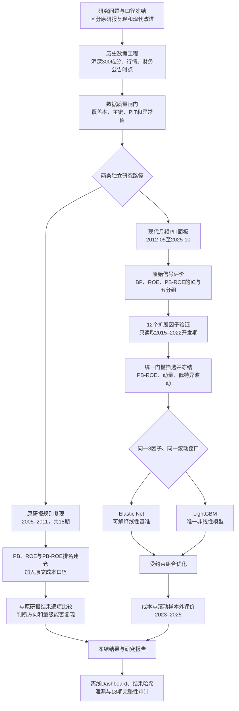
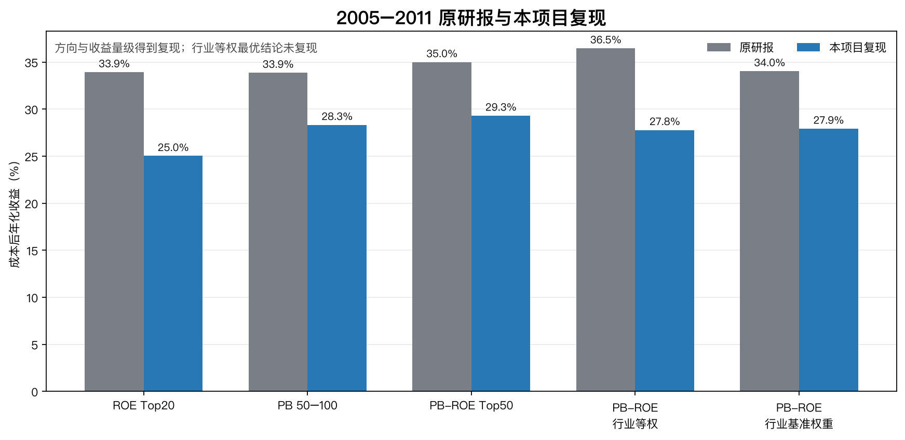
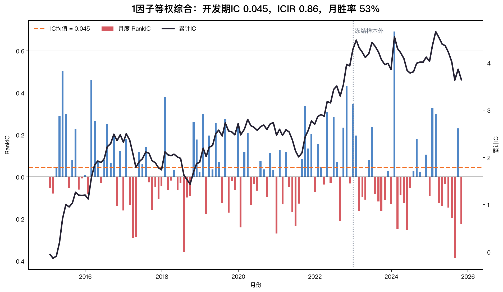
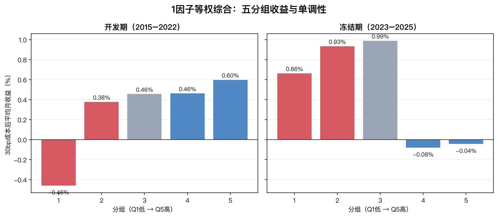
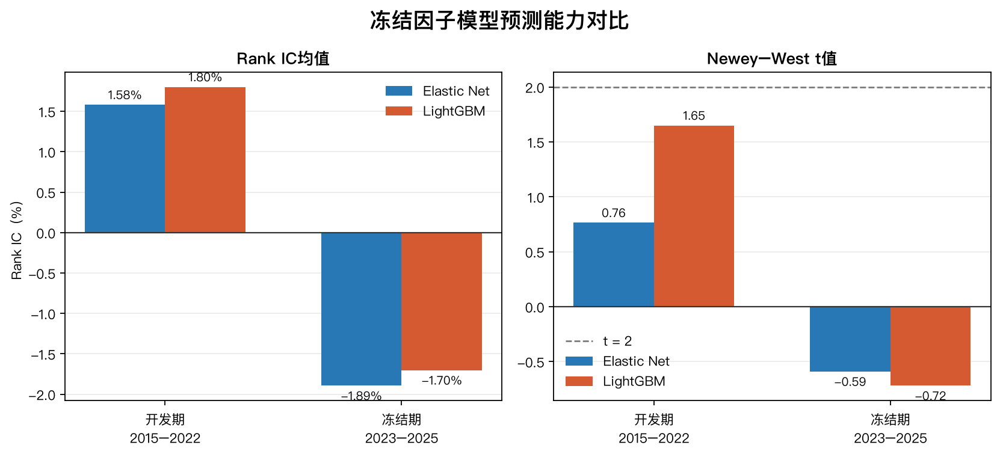
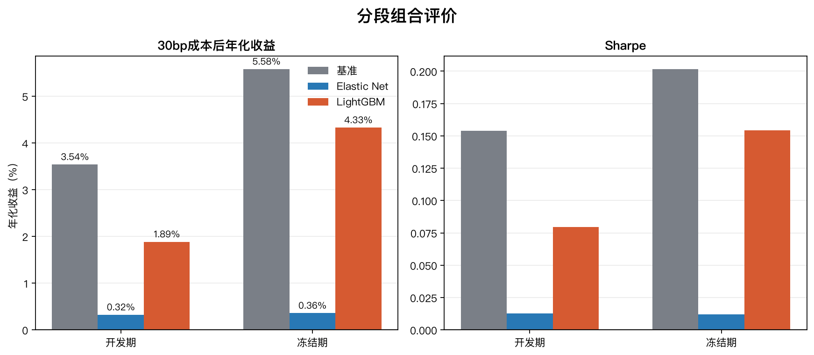

# PB-ROE策略复现与现代改进：最终研究报告

## 工程流程总览



流程图中的两条分支不能混为一个实验：原研报分支没有训练模型，只按固定规则完成历史回测；现代分支才包含因子筛选、滚动训练和组合优化。两条路径最终只在“结论汇总与审计”阶段合并。

| 步骤 | 这一阶段在做什么 | 主要输入 | 主要输出 |
|---|---|---|---|
| 1. 研究口径冻结 | 预先确定股票池、时间窗口、成交规则、成本、开发期和冻结期 | 原论文、项目计划书 | 研究规格、数据字典、停止条件 |
| 2. 历史数据工程 | 还原每个时点的沪深300，整理行情和公告生效后的财务数据 | BaoStock、AKShare/Eastmoney、早期公开财务页 | canonical Parquet数据 |
| 3. 数据质量闸门 | 检查成分数量、覆盖率、主键、价格逻辑和`effective_date <= signal_date` | canonical数据 | 数据审计报告；不通过则停止 |
| 4. 原研报复现 | 按原文PB、ROE和PB-ROE规则进行2005–2011的18期回测 | 原研报规则、历史成分和财务数据 | 原文与复现收益对照 |
| 5. 原始信号现代评价 | 在现代月频样本检验BP、ROE和PB-ROE是否仍有排序能力 | 2012-05后的PIT面板 | IC、五分组、显著性和成本结果 |
| 6. 12因子验证与冻结 | 用统一门槛评价Value、Quality、Growth、Momentum、Risk & Trading候选 | 2015–2022开发期 | 3个冻结因子及等权基准 |
| 7. 滚动模型比较 | 使用相同3因子比较Elastic Net与LightGBM，不随机切分 | 最多60个月历史，LightGBM最后12个月验证 | 每月预测、IC和模型诊断 |
| 8. 组合优化 | 将预测转为满仓、不做空、行业和换手受限的真实多头组合 | 模型预测、252日风险矩阵、上期权重 | 两模型持仓、净收益和求解诊断 |
| 9. 冻结结果展示 | 只读取已有结果生成Matplotlib图、离线Dashboard和报告 | 冻结CSV/Parquet/JSON | 因子报告、最终报告和展示文件 |
| 10. 最终审计 | 检查时间泄漏、18期复现、组合约束、离线性和文件哈希 | 全部冻结产物 | 机器可读审计与结果清单 |

每一步的输出都是下一步的输入：因子没有通过第6步就不能进入模型；模型没有生成冻结预测就不能进入组合；第9和第10步不得重新下载、训练或回测。

## 摘要

本项目包含两个必须分开理解的实验。第一部分是对华泰证券2011年《PB-ROE策略》的**规则复现**：原研报没有训练机器学习模型，而是在2005–2011年历史沪深300中，按当时的PB和ROE进行排序、建仓并计算后续持有期收益。第二部分是现代改进：使用月频point-in-time数据验证原始信号，筛选扩展因子，再比较Elastic Net与唯一树模型LightGBM，最后进行带成本和约束的组合优化。

原研报PB-ROE Top50成本后年化收益为35.00%，本项目18期全窗口复现为29.31%。这支持“低估值与高盈利能力联合排序在原窗口方向正确、收益量级较高”，但不能称为Wind字段的完全数值复刻；原研报行业等权版本最优的结论也没有复现。

现代部分只用2015–2022开发期，从12个候选因子中按预先规定的IC、显著性、五分组单调性和成本门槛保留PB-ROE综合、12–1月动量和低特异波动3个因子。Elastic Net在2023–2025滚动样本外的Rank IC为8.12%，明显高于LightGBM的1.73%。主动风险组合中，Elastic Net冻结期30bp成本后年化7.24%、Sharpe 0.32，对应成分等权代理基准为5.62%和0.20；但信息比率只有0.07，超额主要来自2023年的回撤保护，而且最终主动风险目标是在查看首次冻结期结果后确定的。

因此，最稳健的结论是：**PB-ROE的历史方向和收益量级可以复现；严格筛选后少量因子仍有横截面预测能力；当前样本下Elastic Net比LightGBM稳定。** 现代组合只显示有限、集中且带后验修改的风险调整增量，不能表述为已经发现稳定Alpha。

## 1. 两个实验回答不同问题

### 1.1 原研报规则复现

原研报不是机器学习研究，没有训练集、验证集和调参过程。它的逻辑是：

```text
当期沪深300 → 读取最新PB和ROE → 截面排名 → 建仓 → 观察下一持有期收益
```

这一部分回答：**原研报给出的选股规则，在其历史窗口中能否重现相同方向和接近的收益量级？**

### 1.2 现代因子与模型改进

现代部分才包含因子筛选和机器学习：

```text
现代PB-ROE评价 → 12因子验证 → 3因子冻结
→ Elastic Net / LightGBM滚动预测 → 风险约束组合
```

这一部分回答：**PB-ROE在现代样本是否仍有预测力，新增因子、非线性模型和组合优化是否提供真实增量？**

两个实验的市场环境、频率、成本和基准不同。不能把2005–2011的29.31%与2023–2025的7.24%直接比较并判断策略“变好”或“变差”。

## 2. 时间窗口与数据用途

| 阶段 | 时间 | 实际用途 | 不用于什么 |
|---|---|---|---|
| 原研报复现 | 2005-05至2011-03 | 18期规则回测 | 不训练机器学习模型 |
| 现代行情预热 | 2010-01至2012-04 | 为动量、Beta、波动率和风险矩阵提供历史价格 | 不计入正式现代收益 |
| 现代因子面板 | 2012-05至2025-10 | 评价核心信号和生成模型数据 | 2012–2014不参与因子筛选 |
| 模型初始积累 | 2012-05至2014-04 | 提供最少24个月训练历史 | 不作为正式开发期结论 |
| 开发期 | 2015-01至2022-12 | 筛选因子、冻结方向和参数、评价开发期表现 | 不使用2023年以后结果调参 |
| 滚动样本外 | 2023-01至2025-10 | 按已冻结规则逐月训练和预测 | 不重新选择因子或超参数 |

2010–2012年初并不是一段被遗漏的正式回测。它主要提供历史股价：例如在2012年5月计算12–1月动量、Beta或特异波动，需要读取此前约一年的行情。模型实际最早使用2012-05的因子数据，积累24个月后在2014-05产生第一次预测；正式开发期指标从2015年开始报告。

“滚动样本外”也不等于2022年底训练一次后永不更新。进入2023年以后，已经真实发生的月份可以加入后续训练窗口，但因子名单、方向、筛选门槛和模型超参数不能再根据冻结期结果改变。

股票池始终是每个信号日有效的历史沪深300。当期目标约300只；790只是2010–2025窗口内曾进入沪深300的股票并集，用于下载和还原历史成分，不是中证800股票池。

## 3. 原研报复现：复现了什么

原研报在每年4月30日、8月31日和10月31日前后，分别使用一季报、半年报和三季报信息调整组合。绩效窗口为2005-05至2011-03，共18期。本项目使用每个调仓时点的历史沪深300成分，PB最低覆盖99.67%，ROE最低覆盖99.00%；2005–2006缺失值通过公开历史名单和对应年份财务页面定点补齐，没有重新拉取全部数据。

| 策略 | 原研报成本后年化 | 本项目复现 | 判断 |
|---|---:|---:|---|
| ROE Top20 | 33.93% | 25.02% | 方向一致、幅度较低 |
| PB 50–100 | 33.87% | 28.32% | 方向与量级复现 |
| PB-ROE Top50 | 35.00% | 29.31% | 核心方向基本复现 |
| PB-ROE行业等权 | 36.47% | 27.78% | “行业等权最优”未复现 |



这些结果支持原研报核心方向，但不能证明原文所有数值都能逐项复刻。免费源与Wind字段、行业历史版本、复权和成交假设均可能导致差异；当前证据也不支持仅凭差异判断原研报数据造假。

## 4. 原研报是否使用了未来数据

从规则设计看，原研报没有明显使用未来收益：先在财报披露完成日附近选股，再计算后续持有期收益。但论文没有提供足够信息证明数据层面完全没有前视偏差，主要存在四个不可核实点：

1. Wind中的PB和ROE是否为当时保存的历史版本，还是包含后续修订；
2. 调仓日当天的财报是在开盘前、盘中还是收盘后发布；
3. 使用调仓日收盘价成交时，当天所有财务信息是否已经可见；
4. 非交易日“向前顺延”的方向及历史行业版本如何处理。

例如，如果某公司在4月30日收盘后才发布一季报，回测却使用该报告并按4月30日收盘价成交，就会形成同日未来信息。

本项目现代部分要求 `effective_date <= signal_date`，月末收盘后生成信号，并在下一交易日开盘成交。原研报复现受免费数据限制：2005–2006年ROE按4月30日、8月31日和10月31日统一披露截止日生效，不是逐公司精确公告时点。因此应称为**2005–2011全窗口规则复现**，不能称为完全严格的逐公司PIT或Wind逐值复刻。

## 5. 原研报核心信号在现代样本是否仍有效

2012-05至2025-10共有162个月、48,560个可交易截面观测。该阶段先评价原研报既定信号，不根据结果挑选扩展因子：

| 信号 | Rank IC | NW t值 | 30bp成本后表现 | 解释 |
|---|---:|---:|---:|---|
| BP | 4.56% | 2.50 | 行业调整多空年化3.41% | 价值仍有一定预测力 |
| ROE TTM | 0.50% | 0.43 | 不支持独立有效 | 现代样本中单独作用很弱 |
| PB-ROE综合 | 3.91% | 3.10 | 多空年化2.28% | 统计显著，但经济收益偏弱 |

这里的行业调整是截面回归去除行业均值后对残差信号分层，用于判断信号是否只是行业差异，不等于原研报“每行业前5”的组合规则。

这一步的结论是：原始PB-ROE在现代样本仍有排序信息，但成本后经济收益已经明显弱于2005–2011，不能直接沿用原研报高收益预期。

## 6. 12因子为什么只保留3个

候选覆盖Value、Quality、Growth、Momentum、Risk & Trading五类。筛选只读取2015–2022开发期，没有预设必须选3个、5个或6个。每个候选必须同时满足：

- Rank IC不低于2%；
- Newey–West t值不低于2；
- 五分组平均收益与Q1–Q5顺序的Spearman单调性不低于0.8；
- 30bp成本后Top–Bottom年化收益为正。

| 因子 | 开发期IC | NW t | 五分组单调性 | 30bp多空年化 | 结果 |
|---|---:|---:|---:|---:|---|
| 12–1月动量 | 2.89% | 2.05 | 1.00 | 4.48% | 保留 |
| 低特异波动 | 4.50% | 4.60 | 0.80 | 2.77% | 保留 |
| PB-ROE综合 | 3.67% | 3.70 | 0.90 | 1.64% | 保留 |

其余9个因子因IC、显著性、单调性或成本门槛不合格被淘汰。例如BP、低Beta和反转虽然有正IC，但五分组单调性不足；ROE、增长和流动性等还存在显著性或成本问题。完整逐因子证据见[`factor_analysis_report.md`](factor_analysis_report.md)。

三因子等权得分在开发期IC为6.19%、t值5.69，五组严格递增，30bp多空年化6.94%。冻结期IC为9.87%，但五组不再严格单调，因此只能说排序方向延续，不能说分层结构完全稳定。





## 7. 从因子到模型：每一层增加了什么

模型只使用Commit 06已经冻结的3个因子。Elastic Net和LightGBM采用相同的滚动历史、目标收益和评价区间：

| 层次 | 回答的问题 | 主要结论 |
|---|---|---|
| 三因子等权 | 不训练模型时，组合信号是否有效 | 开发期IC和五分组通过，冻结期单调性减弱 |
| Elastic Net | 线性加权是否优于简单等权 | 冻结期IC达到8.12% |
| LightGBM | 非线性和交互是否提供额外增量 | 冻结期IC仅1.73%，没有超过线性模型 |

Elastic Net每个月使用预测日前最多60个月数据训练。LightGBM同样读取最多60个月历史，但最后12个月用于early stopping；所有训练和验证日期都早于预测月份。

| 模型 | 开发期IC | 冻结期IC | 冻结期NW t | 结论 |
|---|---:|---:|---:|---|
| Elastic Net | 5.55% | 8.12% | 3.74 | 排序预测显著 |
| LightGBM | 2.98% | 1.73% | 0.98 | 不显著，也未超过线性基准 |



当前只有3个稳定方向因子，样本量和特征维度不足以支持可重复的复杂交互。结果说明“模型更复杂”不等于“样本外预测更好”，而不是证明LightGBM在所有量化问题中都无效。

## 8. 模型预测能否转化为组合收益

组合使用Ledoit–Wolf协方差、3%单票上限、行业偏离不超过5%、月换手不超过30%。模型月度预测先乘12，与年化协方差统一量纲；138个月全部求解成功。因免费数据没有可靠的历史沪深300真实权重，基准使用当期可交易成分股等权代理。

| 模型/区间 | 基准年化 | 组合年化 | 基准Sharpe | 组合Sharpe | 基准最大回撤 | 组合最大回撤 |
|---|---:|---:|---:|---:|---:|---:|
| Elastic Net，开发期 | 3.08% | 6.78% | 0.13 | 0.31 | -47.13% | -41.10% |
| Elastic Net，冻结期 | 5.62% | 7.24% | 0.20 | 0.32 | -21.51% | -17.21% |
| LightGBM，冻结期 | 5.62% | 6.10% | 0.20 | 0.21 | -21.51% | -23.78% |



Elastic Net超过基准，但必须同时展示不利证据：

- 冻结期信息比率只有0.07，超额幅度很小；
- 2023年组合通过回撤保护跑赢，但2024和2025均落后基准；
- 绝对超额最大的5个月贡献约44%，收益存在月份集中；
- 平均月换手约29.47%，接近30%上限，真实冲击成本风险较高；
- 50bp成本下年化降至6.49%，相对基准优势进一步缩小。

还有一项关键审计限制必须与组合结果同时出现：最初组合使用总风险目标，结果较差；之后才改成相对成分等权基准的主动风险 `(w-b)'Σ(w-b)`。这一修改有合理的指数增强解释，但发生在查看首次2023–2025结果之后。因此，该区间对最终主动风险版本只能作为**后验稳健性证据**，不能包装成完全未见的独立样本外或实盘验证。

## 9. 最终结论按可信度分层

### 9.1 证据较强的结论

1. PB-ROE Top50在2005–2011的方向和收益量级能够复现，完整补齐2005–2006后年化达到29.31%。
2. 在2015–2022统一门槛下，12个候选中只有3个同时满足IC、显著性、分组单调性和成本要求。
3. 使用相同3因子和滚动口径时，Elastic Net的开发期和冻结期IC都明显高于LightGBM；当前数据不支持非线性模型增量。

### 9.2 有条件成立的结论

1. Elastic Net主动风险组合在开发期和冻结期的年化、Sharpe和回撤优于成分等权代理基准。
2. 这一增量较小、月份集中、对成本敏感，而且最终风险目标存在冻结期后验修改。
3. 因此可以说“预测有一定组合转化能力”，不能说“已经获得稳定可交易Alpha”。

### 9.3 当前不能声称的结论

- 不能声称完全复刻了Wind原始字段和逐公司公告时点；
- 不能证明原研报完全不存在数据层面的未来信息；
- 不能把原研报行业等权最优视为已复现结论；
- 不能声称LightGBM或机器学习普遍优于简单模型；
- 不能把2023–2025最终主动风险结果称为纯粹未见样本或实盘验证。

## 10. 后续最有价值的改进

下一步不应优先增加更多模型，而应提高证据质量：

1. 获得历史沪深300真实权重和可靠历史总市值，替代成分等权代理；
2. 降低换手并加入更现实的冲击成本和容量模型；
3. 对原研报窗口补充逐公司公告时间和历史财务版本；
4. 从新月份开始锁定数据、代码、因子和参数，进行真正前瞻验证。

## 可复现输出

- 原研报对照：[`paper_reproduction_full.csv`](results/paper_reproduction_full.csv)
- 12因子报告：[`factor_analysis_report.md`](factor_analysis_report.md)
- 模型与组合报告：[`portfolio_analysis_report.md`](portfolio_analysis_report.md)
- 冻结因子：[`frozen_factor_selection.json`](results/frozen_factor_selection.json)
- 模型对照：[`portfolio_model_comparison.csv`](results/portfolio_model_comparison.csv)
