# PB-ROE策略复现与现代因子改进：最终研究报告

## 研究主线

```text
原研报PB-ROE规则
    ↓
步骤1：复现2005–2011原研报结果
    ↓
步骤2：评价PB-ROE在2012–2025现代样本是否仍有效
    ↓
步骤3：用统一规则验证12个候选因子并冻结有效因子
    ↓
步骤4：检验三因子等权组合是否优于单一PB-ROE
    ↓
步骤5：比较三因子等权、Elastic Net与LightGBM
    ↓
步骤6：把预测转成受约束多头组合并与基准比较
```

每一步都按“**目标—方法—结果—结果分析**”展开。原研报复现用于回答历史规则能否重现；现代部分始终以原始PB-ROE为基线，只有相对上一层提供增量，才能称为改进。

## 摘要

原研报PB-ROE Top50在2005–2011年的成本后年化收益为35.00%，本项目使用历史沪深300成分、免费行情和财务数据完成18期全窗口规则复现，得到29.31%。核心方向和收益量级能够复现，但行业等权版本最优的结论没有复现，也不能称为Wind字段的逐值复刻。

把原指标放到2012-05至2025-10现代月频样本后，PB-ROE的全样本Rank IC为3.91%，Newey–West t值为3.10，说明仍有横截面排序信息；但30bp成本后多空年化只有0.44%，行业调整后为2.28%，经济收益明显弱于原研报时期。ROE单因子在现代样本基本失效，PB仍保留一定预测力。

在2015–2022开发期统一检验12个候选因子后，只有PB-ROE、12–1月动量和低特异波动同时通过IC、显著性、年度稳定性、五分组单调性和30bp成本门槛。三因子等权在开发期的IC由单一PB-ROE的3.67%提高到6.19%，30bp多空年化由1.64%提高到6.94%，说明现代因子组合确实提供了开发期增量。

加入一个月收益标签隔离期并移除事后收益筛选后，三因子等权、Elastic Net和LightGBM的冻结期IC分别为9.87%、7.82%和3.24%，简单等权仍然最好。Elastic Net冻结期30bp组合年化7.75%，高于成分等权代理基准5.58%，Sharpe为0.34；LightGBM年化7.02%、Sharpe 0.25。升级后的最终审计确认两模型各41,066条预测都满足信号与标签可用性，但组合主动风险目标仍存在查看冻结期后修改的问题，因此组合结果属于后验稳健性证据，而不是未经查看的纯样本外验证。

---

## 步骤0：研究设计与时间窗口

### 目标

在开始比较收益前先冻结股票池、信号时点、成交时点、成本和开发/评价区间，避免把历史复现、因子筛选和模型样本外评价混为同一个实验。

### 方法

- 股票池始终是**每个信号日有效的历史沪深300成分股**；790只是2010–2025年曾进入沪深300的股票并集，不是中证800股票池。
- 原研报复现按原文低频调仓，现代研究按月末生成信号。
- 现代财务数据要求`effective_date <= signal_date`，月末收盘后计算信号，下一交易日开盘成交。
- 信号日在截面内进行1%/99%分位缩尾和z-score标准化；当前代码没有使用MAD缩尾。
- 现代因子成本统一报告10bp、30bp和50bp敏感性，主表使用30bp。
- 开发期允许筛选因子和确定规则；冻结期原则上不得根据结果重新选因子或改参数。

### 结果

| 时间 | 所属步骤 | 数据用途 | 是否直接计入该步骤结果 |
|---|---|---|---:|
| 2005-05至2011-03 | 原研报复现 | 18个持有期规则回测 | 是 |
| 2010-01至2012-04 | 现代数据准备 | 为动量、Beta、波动率和风险矩阵提供历史价格 | 否 |
| 2012-05至2025-10 | 原指标现代评价 | 固定评价BP、ROE和PB-ROE，共162个月 | 是 |
| 2012-05至2014-05 | 模型历史积累 | 生成因子和成熟收益标签 | 否 |
| 2015-01至2022-12 | 因子与模型开发 | 筛选12因子、冻结方向和模型规则 | 计入开发期结果 |
| 2023-01至2025-10 | 冻结评价 | 检查冻结规则是否延续 | 已完成严格时间重跑；组合目标存在后验修改 |

现代因子面板共有162个月、48,560个可交易截面观测。原研报复现中，PB最低覆盖99.67%，ROE最低覆盖99.00%；2005–2006缺失值通过定点补充历史名单和对应年份财务页面解决。

### 结果分析

2010–2012年初只是历史价格准备，不是没有展示结果的回测。2012-05是PB和ROE覆盖率连续通过80%闸门后的现代评价起点；2015年才开始筛选候选因子，目的是让模型在进入开发期前已有足够历史。

2005–2011的29.31%和2023–2025的组合年化不能直接比较：两者调仓频率、成交价、成本、基准和市场环境都不同。正确的比较顺序是先在各自口径内评价，再判断现代扩展是否相对现代PB-ROE基线提供增量。

---

## 步骤1：复现原研报PB-ROE策略

### 目标

验证华泰证券2011年《PB-ROE策略》的固定选股规则，在原论文历史窗口中能否重现相同方向和接近的收益量级。

### 方法

原研报综合分数为：

$$
Score_{i,t}=PctRank(ROE_{i,t})+1-PctRank(PB_{i,t})
$$

高ROE提高分数，高PB降低分数，因此高分表示“盈利能力较高且估值较低”。本项目在2005–2011年每年4月30日、8月31日和10月31日前后调仓，使用当期历史沪深300成分和最新可用PB、ROE；非交易日按配置顺延到下一交易日，按收盘价成交。初始建仓成本0.6%，后续调仓成本1.3%。核心组合选择PB-ROE得分前50只并等权持有，同时复现ROE、PB和行业版本作为对照。

### 结果

| 策略 | 原研报成本后年化 | 本项目复现 | 复现胜基准期数 | 判断 |
|---|---:|---:|---:|---|
| ROE Top20 | 33.93% | 25.02% | 10/18 | 方向一致、幅度较低 |
| PB 50–100 | 33.87% | 28.32% | 9/18 | 方向与量级接近 |
| PB-ROE Top50 | 35.00% | 29.31% | 12/18 | 核心策略基本复现 |
| PB-ROE行业等权 | 36.47% | 27.78% | 13/18 | “行业等权最优”未复现 |


### 结果分析

PB-ROE Top50的收益方向与原文一致，年化差距约5.69个百分点，支持“低估值与高盈利联合排序在原窗口有效”，但不支持原文所有数值逐项一致。差异可能来自免费数据与Wind字段定义、历史行业版本、复权方式和成交细节。

原研报规则本身没有直接使用未来收益，但论文没有提供足够信息证明底层Wind历史字段完全point-in-time。2005–2006补充ROE也只能按统一财报截止日生效，不是逐公司精确公告时点。因此本步骤应称为**全窗口规则复现**，不能称为严格逐值复刻，也没有证据仅凭差异判断原研报造假。

---

## 步骤2：评价原始PB-ROE在现代样本是否仍有效

### 目标

把原研报已经给定的BP、ROE和PB-ROE信号放到现代沪深300月频样本中，判断它们是否仍具有统计预测力、分层结构和成本后经济收益。

### 方法

评价区间为2012-05至2025-10，共162个月。每月对BP、ROE和PB-ROE进行1%/99%分位缩尾与截面z-score，计算当月因子与下一持有期收益的Spearman Rank IC、ICIR、IC正值比例和Newey–West t值，并进行五分组回测。

除原始信号外，还通过截面行业虚拟变量回归去除行业均值，对残差信号重新分组。这个“行业调整”用于检查信号是否只是行业差异，不等于原研报“每个行业选前5只”的组合规则。

### 结果

| 信号 | 原始IC | 原始NW t | 原始30bp多空年化 | 行业调整IC | 行业调整NW t | 行业调整30bp多空年化 |
|---|---:|---:|---:|---:|---:|---:|
| BP | 4.56% | 2.50 | 0.77% | 3.13% | 2.83 | 3.41% |
| ROE TTM | 0.50% | 0.43 | -2.73% | 0.73% | 1.06 | -2.63% |
| PB-ROE | 3.91% | 3.10 | 0.44% | 3.03% | 3.69 | 2.28% |

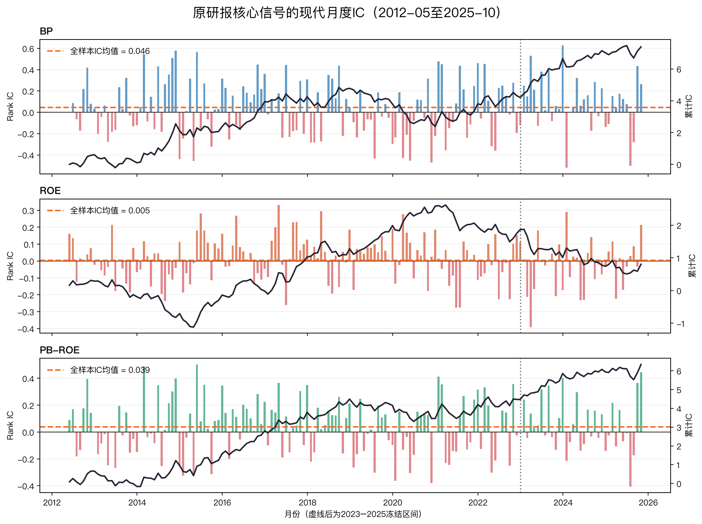

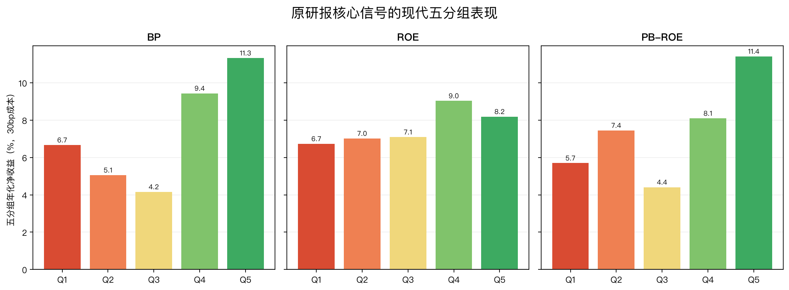

### 结果分析

- BP和PB-ROE的IC显著为正，说明便宜估值以及价值与盈利的联合排序在现代样本仍包含信息。
- ROE单因子IC接近0且成本后收益为负，原研报时期的高ROE效应没有在现代样本稳定延续。
- PB-ROE的全样本IC为3.91%，但原始30bp多空年化只有0.44%；行业调整后经济收益提高到2.28%，仍远低于原研报时期的高收益。
- 五分组图显示PB-ROE的组间顺序比ROE清晰，但高IC不自动等于高可交易收益，换手和成本会显著压缩多空价差。

结论是：**PB-ROE在现代样本仍有统计排序能力，但不能直接沿用原研报35%年化的收益预期。** 这一步给后续因子改进建立了现代基线。

---

## 步骤3：验证12个候选因子并冻结有效名单

### 目标

寻找相对单一PB-ROE能够提供增量、且不是只靠偶然IC或极端分组获利的现代因子。因子数量不预设为3个、5个或6个，只有通过统一门槛的因子才能进入下一步。

### 方法

候选覆盖Value、Quality、Growth、Momentum和Risk & Trading五类。筛选只读取2015-01至2022-12开发期，统一执行：

1. 月度覆盖率不低于80%；
2. 方向调整后Rank IC不低于2%；
3. Newey–West t值不低于2；
4. 年度平均IC为正的比例不低于50%；
5. 五分组收益与Q1–Q5序号的Spearman单调性不低于0.8；
6. 30bp成本后Q5–Q1年化收益为正。

五分组单调性0.8表示整体排序清晰，允许中间相邻组有少量噪声；它不要求每两根相邻柱都严格递增。

### 结果

| 因子 | 类别 | 开发期IC | NW t | 单调性 | 30bp多空年化 | 结果/失败原因 |
|---|---|---:|---:|---:|---:|---|
| 盈利增长 | Growth | 0.53% | 0.85 | 0.60 | 0.50% | IC、t、单调性失败 |
| 营收增长 | Growth | 0.33% | 0.41 | 0.70 | 0.72% | IC、t、单调性失败 |
| 12–1月动量 | Momentum | 2.89% | 2.05 | 1.00 | 4.48% | **保留** |
| 1月反转 | Momentum | 2.87% | 2.17 | 0.60 | 1.84% | 单调性失败 |
| 毛利率 | Quality | 0.68% | 1.01 | 0.60 | 0.80% | IC、t、单调性失败 |
| ROE | Quality | 1.90% | 1.97 | 0.20 | -1.12% | IC、t、单调性、成本失败 |
| 低Beta | Risk & Trading | 3.40% | 2.89 | 0.70 | 0.13% | 单调性失败 |
| 低特异波动 | Risk & Trading | 4.50% | 4.60 | 0.80 | 2.77% | **保留** |
| 低流动性 | Risk & Trading | 1.27% | 1.11 | -0.40 | -4.45% | IC、t、单调性、成本失败 |
| 低总波动率 | Risk & Trading | 3.76% | 4.12 | 0.50 | -0.73% | 单调性、成本失败 |
| BP | Value | 2.76% | 2.52 | 0.70 | 1.01% | 单调性失败 |
| PB-ROE | Value | 3.67% | 3.70 | 0.90 | 1.64% | **保留** |

三个保留因子的开发期图如下。全部12个因子的定义、公司财务含义、IC图和分组图见[因子分析报告](factor_analysis_report.md)。

| 因子 | 月度IC与累计IC | 五分组收益与净值 |
|---|---|---|
| PB-ROE | 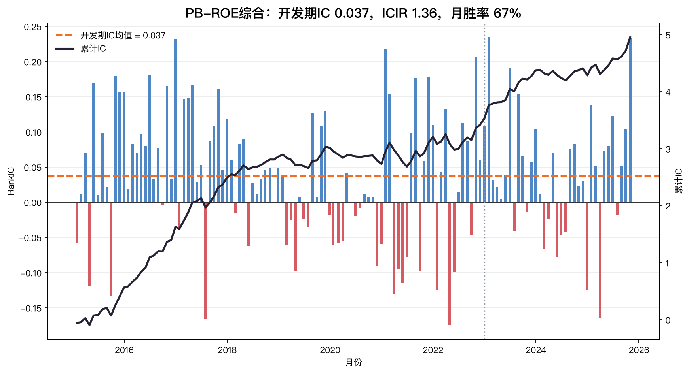 | 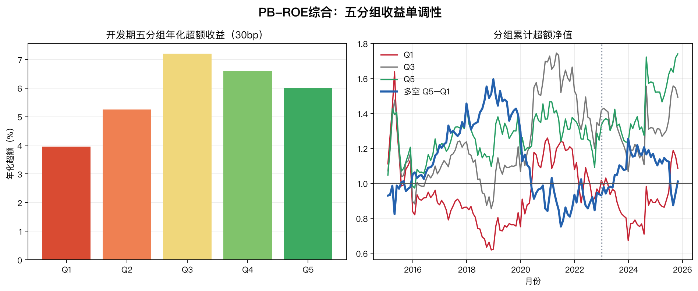 |
| 12–1月动量 | 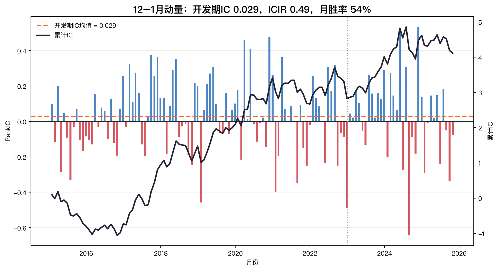 | 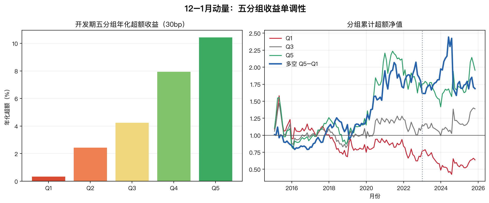 |
| 低特异波动 | 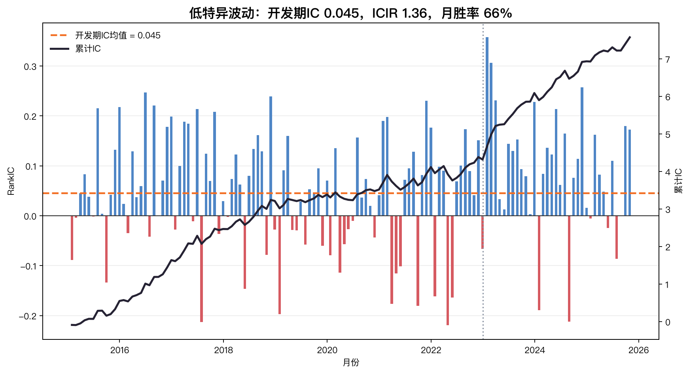 | 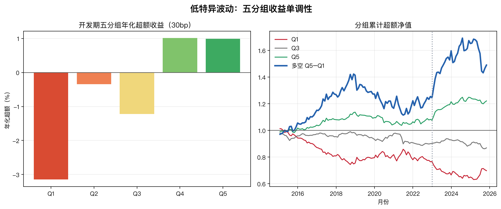 |

### 结果分析

保留PB-ROE不是因为原论文使用了它，而是因为它在开发期也通过全部统一门槛。动量的IC和t值只是刚过线，但五分组完全单调、成本后收益最高；低特异波动的IC、显著性和年度稳定性最强，但单调性恰好等于0.8，不能描述为五组严格递增。

BP、低Beta和低总波动率并非完全无效，它们有正IC，但分层或成本门槛不合格。严格执行统一规则比事后把“差一点”的因子加入更重要。三个保留因子之间的相关系数绝对值最高约0.43，说明存在相关性但并非完全重复，为组合提供了互补空间。

---

## 步骤4：检验三因子等权是否改进单一PB-ROE

### 目标

在引入机器学习前建立最简单、最透明的现代改进基准：如果三个有效因子直接等权都不能优于单一PB-ROE，就没有必要继续增加模型复杂度。

### 方法

每月将方向调整后的PB-ROE、12–1月动量和低特异波动z-score等权平均：

$$
Score^{EW}_{i,t}=\frac{z(PB\text{-}ROE)_{i,t}+z(Momentum)_{i,t}-z(IdioVol)_{i,t}}{3}
$$

开发期为2015–2022，冻结诊断期为2023–2025。评价指标与单因子相同，包括IC、Newey–West t、五分组和10/30/50bp多空收益。

### 结果

| 指标 | 单一PB-ROE开发期 | 三因子等权开发期 | 三因子等权冻结期 |
|---|---:|---:|---:|
| Rank IC | 3.67% | 6.19% | 9.87% |
| NW t | 3.70 | 5.69 | 5.18 |
| 30bp多空年化 | 1.64% | 6.94% | 2.51% |
| 五分组结构 | 单调性0.90 | Q1至Q5严格递增 | Q5最高，但Q1/Q2反转 |


### 结果分析

在开发期，三因子等权相对单一PB-ROE同时提高IC、显著性和成本后收益，是本项目目前最清楚的现代改进证据。冻结期IC继续为正，但30bp年化降到2.51%，而且五组不再严格单调，说明排序方向延续不等于经济结构完全稳定。

三因子等权是后续模型必须超过的基准。机器学习不能只比另一个机器学习模型好，还必须证明它比这个透明的简单组合提供增量。

---

## 步骤5：Walk-forward比较等权、Elastic Net与LightGBM

### 目标

检验线性动态加权或非线性交互能否超过三因子等权，而不是默认复杂模型一定更好。

### 方法

模型目标是行业调整后的下一持有期收益。某月末信号的标签定义为：

```text
本月末后的第一个可交易开盘价
到下一个月末后的第一个可交易开盘价之间的收益
```

严格walk-forward每个月应按以下顺序执行：

```text
月末收盘冻结当时可见的成分、财务和行情
    ↓
只保留exit_date已经早于或等于本月信号日的成熟收益标签
    ↓
从成熟标签中取最近最多60个月；不足24个月则不预测
    ↓
当月重新训练模型并预测全部可交易股票
    ↓
下一交易日开盘成交；收益完整实现后才进入未来训练集
```

Elastic Net使用全部滚动训练历史，固定`alpha=0.001`、`l1_ratio=0.20`。LightGBM在完整60个月窗口中使用较早48个月拟合、最近12个月做time-ordered early stopping；早期窗口的验证段取历史月份约三分之一且不超过12个月。两者使用相同3个因子、相同标签和相同预测月份。

以2023-01-31为例，2022-11信号的收益在2023-01-03已经完整，可用于训练；2022-12信号的收益要到2023-02-01才完整，不能用于1月31日预测。因此严格训练历史最多只能到2022-11，形成一个月标签隔离期。

### 结果

严格标签隔离后的结果如下：

| 方法 | 开发期IC | 开发期NW t | 冻结期IC | 冻结期NW t | 相对简单等权 |
|---|---:|---:|---:|---:|---|
| 三因子等权 | 6.19% | 5.69 | 9.87% | 5.18 | 基准 |
| Elastic Net | 5.56% | 4.59 | 7.82% | 3.58 | 两段都低于等权 |
| LightGBM | 2.66% | 3.84 | 3.24% | 2.00 | 低于等权，冻结期仅刚过显著线 |

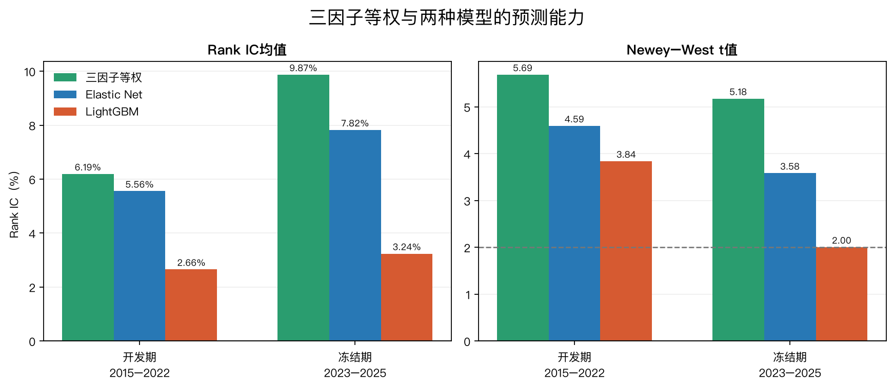

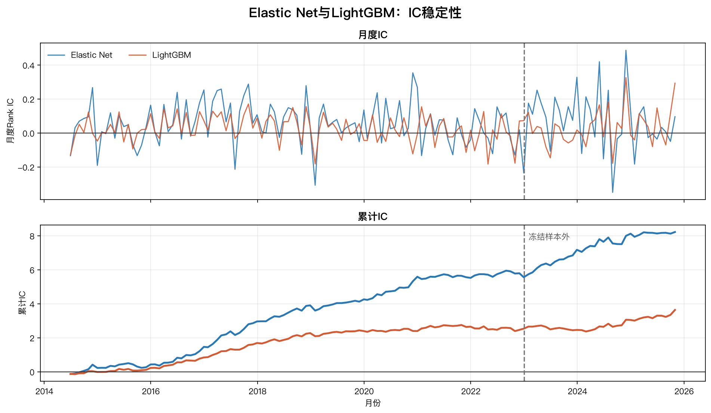

### 结果分析

严格重跑仍没有证明机器学习优于简单组合：三因子等权在开发期和冻结期的IC都高于Elastic Net，Elastic Net只是在两个机器学习模型中优于LightGBM。当前只有3个低维因子，线性关系占主导，LightGBM的复杂交互缺乏稳定样本支持。

时间实现问题已经修正。2023-01-31的Elastic Net训练信号最晚为2022-11-30，训练标签最晚退出日为2023-01-03；LightGBM验证信号最晚同样为2022-11-30，验证标签最晚退出日为2023-01-03，均早于预测日。升级审计不再只检查`training_end < signal_date`，还强制检查训练和验证标签的`exit_date <= signal_date`。

---

## 步骤6：将模型预测转成可交易多头组合

### 目标

判断横截面预测能力能否在满仓、不做空、成本、行业和换手约束下转化为真实多头收益，并与沪深300成分等权代理基准比较。

### 方法

- 用截至信号日的过去252个交易日收益估计Ledoit–Wolf协方差；
- 将月度模型预测乘12，与年化协方差统一量纲；
- 优化相对成分等权基准的主动风险；
- 约束满仓、不做空、单票不超过3%、行业偏离不超过5%、月换手不超过30%；
- 下一交易日开盘成交，报告10bp、30bp、50bp成本；
- 因缺少可靠的历史沪深300真实权重，基准使用当期可交易成分等权代理。

### 结果

严格时间修正后的组合结果如下：

| 模型/区间 | 基准年化 | 组合年化 | 基准Sharpe | 组合Sharpe | 基准最大回撤 | 组合最大回撤 |
|---|---:|---:|---:|---:|---:|---:|
| Elastic Net，开发期 | 3.54% | 6.85% | 0.15 | 0.31 | -43.66% | -40.70% |
| Elastic Net，冻结期 | 5.58% | 7.75% | 0.20 | 0.34 | -21.51% | -16.85% |
| LightGBM，冻结期 | 5.58% | 7.02% | 0.20 | 0.25 | -21.51% | -23.59% |

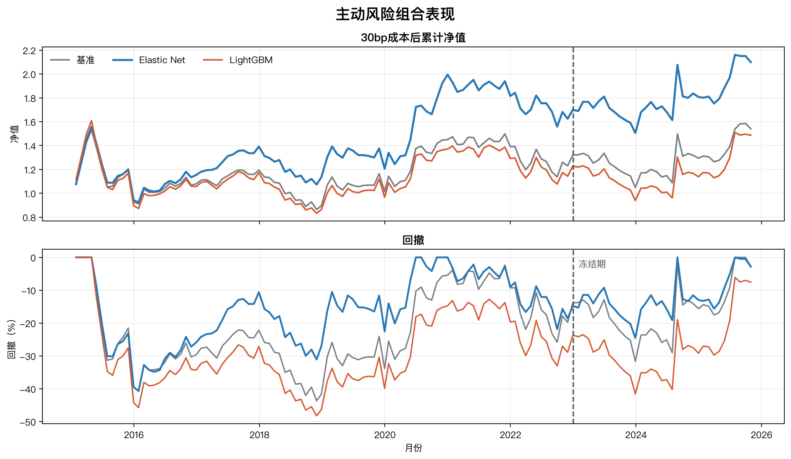


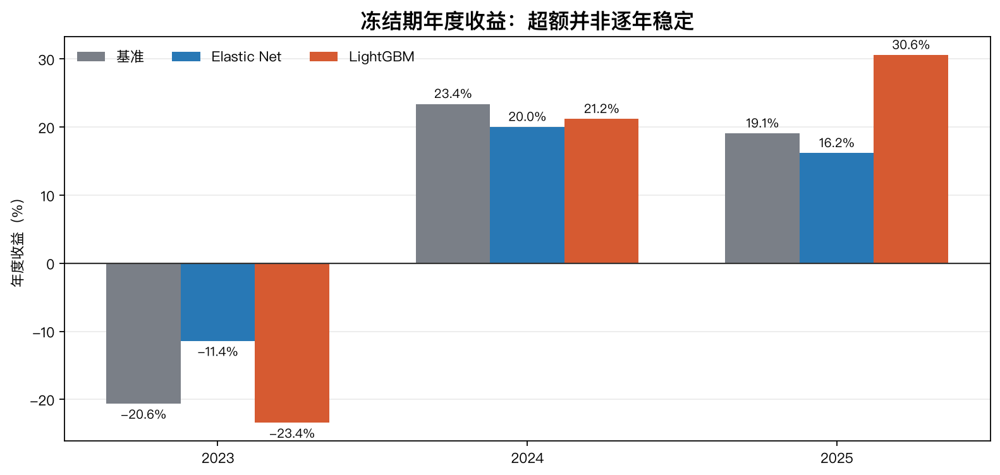

### 结果分析

严格重跑后Elastic Net冻结期年化比基准高2.17个百分点，但平均年度超额只有1.11个百分点，信息比率0.13；超额仍主要来自2023年的回撤保护，2024和2025均落后基准。平均月换手29.20%，接近30%上限，50bp成本下年化降至7.00%，相对基准优势只剩约1.42个百分点。

这组结果还有两项比收益数值更重要的限制：

1. 组合入选已不再读取未来`forward_return`；无法在五个交易日内获得完整退出价格的持仓在绩效中按0收益保守处理。该缺失权重的单月最大值约为Elastic Net 7.09%、LightGBM 11.27%，仍需用真实持仓延续账本改进。
2. 主动风险目标是在查看首次2023–2025结果后由总风险目标修改而来。这个修改有指数增强逻辑，但冻结期已被查看，只能视为后验稳健性证据。

因此可以说：严格时间口径下，Elastic Net组合在该冻结区间的收益、Sharpe和回撤都优于成分等权代理；但信息比率低、年度胜率不稳定、目标函数有后验修改，仍不能证明已经获得可持续的实盘Alpha。

---

## 步骤7：逐步结论与项目回答

| 研究问题 | 当前回答 | 证据状态 |
|---|---|---|
| 原研报PB-ROE能否复现？ | Top50年化29.31% vs 原文35.00%，方向与量级基本复现 | 较强 |
| PB-ROE在现代样本仍有效吗？ | IC显著为正，但30bp经济收益明显减弱 | 较强 |
| 哪些现代因子通过统一验证？ | PB-ROE、12–1月动量、低特异波动 | 较强，仅限2015–2022筛选规则 |
| 三因子组合是否改进PB-ROE？ | 开发期IC和成本后收益均明显提高；冻结期分组结构减弱 | 中等 |
| Elastic Net是否优于三因子等权？ | 没有，严格重跑IC仍低于等权 | 较强 |
| LightGBM是否提供非线性增量？ | 没有，冻结期IC仅刚过t=2且明显低于等权和Elastic Net | 较强 |
| 优化组合是否稳定跑赢基准？ | Elastic Net该区间指标较好，但超额集中且存在后验目标修改 | 有条件成立 |

目前可以正式陈述的核心结论是：

1. 原研报PB-ROE的历史方向和收益量级能够复现，但行业等权最优没有复现。
2. PB-ROE在现代样本仍有统计排序能力，经济收益却显著下降。
3. 在统一开发期门槛下，动量和低特异波动为PB-ROE提供了可观察的增量，三因子等权是当前最有说服力的现代改进。
4. 现有证据不支持“模型越复杂越好”；严格重跑后三因子等权仍优于Elastic Net，Elastic Net优于LightGBM。
5. 严格标签时间问题已经解决，但组合超额不稳定且存在后验目标修改，不能声称获得稳定实盘Alpha。

## 下一步最有价值的改进

1. 将缺失未来收益的0收益保守核算升级为可延续停牌持仓、按真实可成交日退出的组合账本；
2. 后续新增月份到来前冻结当前代码与参数，建立真正未查看的前瞻区间；
3. 获得历史沪深300真实权重，替换当前成分等权代理基准；
4. 加入更现实的冲击成本、成交量和容量约束；
5. 根据本次严格重跑结果更新10分钟PPT。

## 可复现证据

- 原研报复现结果：[paper_reproduction_full.csv](results/paper_reproduction_full.csv)
- 现代核心信号结果：[modern_factor_baseline.csv](results/modern_factor_baseline.csv)
- 12因子总表：[factor_validation_summary.csv](results/factor_validation_summary.csv)
- 完整因子分析：[factor_analysis_report.md](factor_analysis_report.md)
- 冻结因子名单：[frozen_factor_selection.json](results/frozen_factor_selection.json)
- 三因子等权结果：[equal_weight_factor_baseline.csv](results/equal_weight_factor_baseline.csv)
- 模型汇总：[elastic_net_summary.csv](results/elastic_net_summary.csv)、[lightgbm_summary.csv](results/lightgbm_summary.csv)
- 组合对照：[portfolio_model_comparison.csv](results/portfolio_model_comparison.csv)
- 组合分析：[portfolio_analysis_report.md](portfolio_analysis_report.md)
- Matplotlib绘图代码：[plot_modern_core_factors.py](../scripts/plot_modern_core_factors.py)、[plot_all_factor_analysis.py](../scripts/plot_all_factor_analysis.py)、[plot_signal_method_comparison.py](../scripts/plot_signal_method_comparison.py)、[plot_portfolio_analysis.py](../scripts/plot_portfolio_analysis.py)
