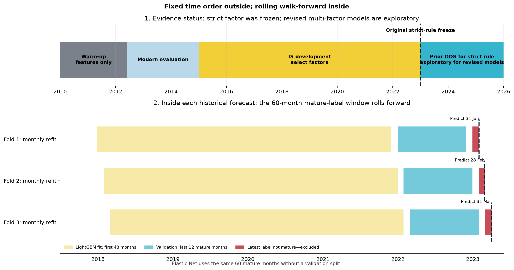
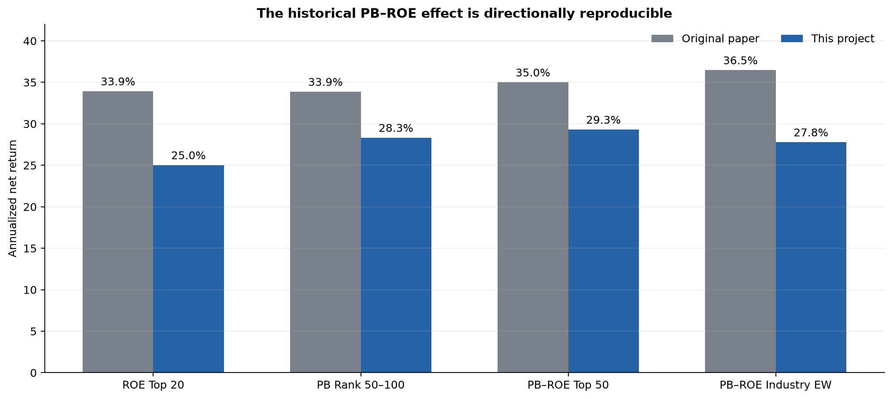
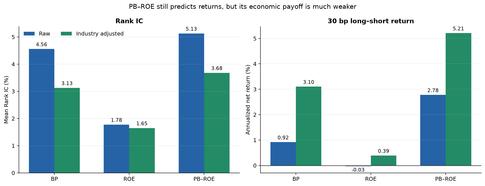
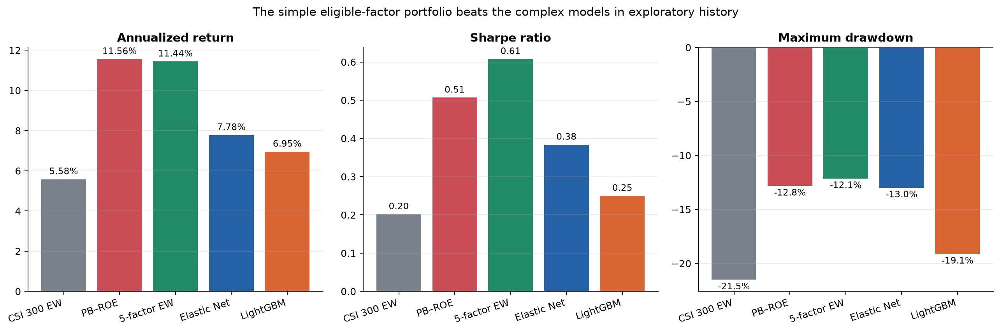

# PB-ROE策略复现、评价与现代多因子改进

## 工程主线：原方法怎样走到现代改进

```text
华泰2011年PB-ROE研报
  ↓
1. 原文规则复现：2005–2011完整18期
  ↓  判断历史方向和量级能否复现
2. 现代PB-ROE再评价：IC、五分组、成本后多空
  ↓  发现仍有排序信息，但单调性和经济幅度较弱
3. 诊断“PB-ROE还缺什么”：只有价值 + 盈利两个维度
  ↓
4. 8因子独立评价（保留负面证据）
  ├─ 严格独立门槛：唯一通过1个月反转，后段预留检验失败
  └─ 6个扩展候选相对PB-ROE做残差IC、Add-one和年度改善检验
       ↓
5. 冻结模型输入：BP + ROE核心，3个扩展提供增量，共5因子
  ↓
6. 先做5因子方向等权，再用同一输入训练Elastic Net和LightGBM
  ↓
7. PB-ROE、5因子等权、Elastic Net、LightGBM进入同一组合优化器
  ↓
8. 比较IC、收益、Sharpe、回撤、换手和成本；机器审计后冻结结论
```

这不是“先随便找因子，再上机器学习”。第2步先暴露PB-ROE的问题，第3–5步才说明为什么加入某个扩展因子；只有证明相对PB-ROE有开发期增量的候选才能进入模型。严格单因子评价仍保留，但它回答“能否独立交易”，不是“能否作为组合输入”。

## 摘要

本项目方向性复现了华泰证券2011年《PB-ROE策略》的2005–2011完整18期规则，并实现一个包含point-in-time财务时点、历史沪深300成分、现代因子评价、walk-forward模型、风险约束组合和机器审计的业界研究MVP。

原文层中，PB-ROE Top50成本后年化为29.86%，原文为35.00%，18期中12期跑赢成分等权代理；历史方向和量级基本复现，但“行业等权版本最佳”没有复现。

现代层中，PB-ROE全期Rank IC为5.13%、Newey-West t值3.73，但30bp后多空年化只有2.78%，五组单调性0.70，说明排序信息仍在，交易经济性显著弱于原研报时期。8因子严格独立筛选仍只选出1个月反转，它在预留的2023–2025区间IC转为-1.89%，独立因子改进失败。

随后以PB-ROE为明确基线，对6个扩展因子做开发期残差IC、Add-one IC和年度改善率检验。12–1月动量、1个月反转和低60日波动通过；EP、OCF/P和营收增长未通过Add-one增量。加上核心BP与ROE形成5因子manifest。5因子方向等权的开发/探索IC为7.81%/8.35%，均高于PB-ROE的4.32%/7.22%。训练目标改为与Rank IC一致的月内收益排名后，Elastic Net和LightGBM探索IC为8.86%和8.42%；线性模型略高于等权，树模型仍未超过线性模型。

2023–2025探索性历史组合中，30bp后PB-ROE、5因子等权、Elastic Net和LightGBM年化分别为11.56%、11.44%、7.78%和6.95%，等权基准为5.58%。5因子等权Sharpe为0.61、最大回撤-12.14%，风险调整后最好，但绝对年化未超过PB-ROE。模型Rank IC改善没有完整转化为组合收益；且该区间已被查看，不能称新版策略真正样本外。

最终结论是：**PB-ROE历史效应可以方向性复现；现代PB-ROE仍有信息但经济性变弱；5因子分散改善风险调整表现但没有提高绝对年化；Elastic Net只有排序增量、LightGBM没有证明非线性增量；下一步必须冻结当前版本并等待新增月份前瞻检验。**

## 1. 研究问题与成功标准

### 目标

依次回答原研报能否复现、现代PB-ROE是否仍有效、扩展因子为何加入、复杂模型是否增量、组合约束后能否超过基准。

### 方法

每一层都设置一个更简单的对照：原文数字、现代PB-ROE、5因子等权、沪深300成分等权代理。所有规则、时间窗、成本和门槛写入配置或manifest后再运行。

### 结果与分析

项目成功标准不是强制跑赢，而是数据可追溯、无明显前视、比较顺序合理、负结果保留、证据状态准确且同一配置可重跑。当前结果满足工程MVP标准，但不满足“复杂模型已通过真正样本外”的更强声明。

## 2. 时间框架与walk-forward

### 2.1 两条历史线

```text
原文复现： 2005 ───────────────────────── 2011-03-25
             4/30、8/31、10/31调仓，共18个正式持有期

现代研究： 2010 ───── 2012-05 ───── 2015 ───────────── 2023 ───── 2025
             历史热身     描述评价       开发、筛选、滚动训练      历史检验
```

| 区间 | 目标 | 实际做法 | 证据状态 |
|---|---|---|---|
| 2005Q1–2011-03-25 | 原研报复现 | 18期规则回测 | 原文层正式结果 |
| 2010-01–2012-04 | 现代特征热身 | 积累12–1动量、60日波动和风险矩阵所需历史；PB/ROE覆盖尚未连续达标 | 不输出现代收益结论 |
| 2012-05–2014-12 | 现代PB-ROE评价准备 | 覆盖达标后计算月频描述指标 | 描述性，不选扩展因子 |
| 2015-01–2022-12 | 统一开发期 | 独立因子评价、PB-ROE增量筛选、模型walk-forward | 可用于开发与冻结 |
| 2023-01–2025-10完整标签月 | 后段历史检验 | 旧严格反转不再改规则；新版5因子与模型仅展示 | 严格反转为预留检验；新版方案为探索性 |
| 本版冻结后的新增月份 | 真正前瞻检验 | 不改manifest、参数和成本，只追加数据 | 未来证据 |

2010开始保存行情不等于现代模型“没有回测”。它先提供计算历史特征所需的过去数据；正式现代评价从核心数据覆盖达标后开始，开发结论从2015开始。

### 2.2 每个月怎样避免未来标签

预测月T只使用信号日早于T、且该信号持有期退出日不晚于T的成熟标签。训练窗最长60个月、最少24个月。模型训练目标是每个月下一期个股收益的截面百分位排名并中心化到-0.5至0.5，以匹配Rank IC；组合回测仍使用真实收益。Elastic Net用完整成熟窗；LightGBM用前48个月拟合、最后12个成熟月按时间验证和early stopping。随后预测T月，在下一交易日开盘形成持仓。

代码没有使用未来收益，但研究者已经见过2023–2025，因此新版方案在该区间仍必须写成探索性。这是“数据泄漏”和“研究过程泄漏”的区别。



## 3. 数据与PIT审计

### 目标

确保每个历史信号只使用当时可见信息，不用今天的股票池、修订日期或静态行业重写历史。

### 方法

使用调仓日有效的沪深300历史成分。790只是窗口内曾进入过沪深300的证券并集，用于下载和还原，并非中证800。现代财务首次可见日使用Eastmoney `NOTICE_DATE`；canonical文件保存SHA-256和manifest；静态BaoStock行业不进入正式历史标签和行业约束。

### 结果

正式现代数据审计17项全部通过；原文层为2005–2011完整18期。当前配置指纹为`2d2d6423df3fca31`，canonical输入manifest哈希被写入模型manifest。最终机器审计31项全部通过。

### 结果分析与限制

免费源不能逐值复制Wind历史快照；2005–2006早期ROE仍使用统一披露截止日；缺少可靠PIT行业、真实历史指数权重和完整退市持仓账本。因此本项目可以称规则复现和研究MVP，不能称Wind逐值复刻或可直接实盘。

## 4. 原研报规则复现

### 目标

检验低PB、高ROE及综合排序在原窗口是否具有研报所述方向和量级。

### 方法

在4/30、8/31、10/31使用当时沪深300成员和可得财报，构建ROE Top20、PB 50–100、PB-ROE Top50及两个行业版本；应用原文初始0.6%、后续1.3%的成本假设。

### 结果

| 策略 | 原文年化 | 本项目年化 | 本项目跑赢等权期数 |
|---|---:|---:|---:|
| ROE Top20 | 33.93% | 25.27% | 10/18 |
| PB 50–100 | 33.87% | 29.27% | 10/18 |
| PB-ROE Top50 | 35.00% | 29.86% | 12/18 |
| PB-ROE行业等权 | 36.47% | 28.00% | 13/18 |
| PB-ROE行业基准权重 | 34.04% | 28.51% | 14/18 |
| 沪深300成分等权代理 | — | 28.98% | — |



### 结果分析

PB-ROE Top50方向与量级基本复现，但仅比成分等权代理高约0.88个百分点；行业等权不是本数据中最佳版本。差异可能来自Wind字段、行业分类、复权和早期ROE时点，现有证据不能推出原研报造假。

## 5. 现代PB-ROE再评价

### 目标

判断历史价值质量规律在月频、PIT和现代成本口径下是否仍有预测力与可交易性。

### 方法

每月对BP、ROE和PB-ROE做1%/99%分位缩尾和z-score，计算下一持有期Rank IC、Newey-West t、五分组单调性和10/30/50bp多空收益。当前实现不是MAD去极值。静态行业调整只作敏感性诊断。

### 结果

| 因子 | 全期IC | NW t | 五组单调性 | 30bp多空年化 |
|---|---:|---:|---:|---:|
| BP | 4.56% | 2.50 | 0.60 | 0.92% |
| ROE | 1.78% | 1.22 | 0.90 | -0.03% |
| PB-ROE | 5.13% | 3.73 | 0.70 | 2.78% |



### 结果分析

PB-ROE的排序信息强于单独BP或ROE，价值与质量互补仍存在；但收益单调性和成本后幅度远弱于原研报。这正是扩展动量、交易和风险维度的研究动机，而不是直接因为“机器学习可能更强”。

## 6. 8因子独立评价

### 目标

不预设通过数量，找出能单独构成统计和经济上合格策略的因子，并保存失败证据。

### 方法

2015–2022同时要求IC≥2%、NW t≥2、正IC年份≥50%、五组单调性≥0.80、30bp多空年化为正。

### 结果

唯一通过者是1个月反转：开发IC 4.47%、t值2.29、单调性1.00、30bp多空年化5.92%；但其预留区间IC为-1.89%、t值-0.59，优化组合年化-4.84%。


### 结果分析

严格筛选没有保证跨期稳定。不能看见后段低波或BP表现较好后倒推替换名单，否则会把检验期变成第二个开发期。每个因子的公式、市场规律、表现与限制见[`factor_analysis_report.md`](factor_analysis_report.md)。

## 7. PB-ROE增量筛选与5因子冻结

### 目标

建立第2步“PB-ROE问题诊断”到第3步“现代扩展”的明确桥梁：候选不仅数据合格，还必须证明提供PB、ROE之外的信息并改善PB-ROE。

### 方法

BP和ROE作为核心永久保留。对EP、OCF/P、营收增长、12–1月动量、1个月反转和低60日波动6个扩展候选，在开发期逐月回归`candidate ~ BP + ROE`并计算残差IC；再构造`2/3 PB-ROE + 1/3 candidate`的Add-one信号。要求月均绝对相关<0.85、残差IC>0、Add-one IC增量>0、至少50%的开发年份改善，并通过覆盖、方向和冗余检查。

### 结果

通过者为12–1月动量、1个月反转和低60日波动。EP残差IC和Add-one均为负；OCF/P与营收增长虽有正残差IC，但Add-one IC下降。加上BP、ROE，最终共5因子。


### 结果分析

这不是放宽严格门槛：独立层仍只有反转通过；增量层回答一个弱因子能否在组合中补充PB-ROE。新增财务因子没有因为“更容易讲”就被强制保留；低波即使单独30bp收益不理想，也因开发期增量进入后续统一比较。

## 8. 等权、Elastic Net与LightGBM

### 目标

先建立低参数的5因子方向等权基准，再检验动态线性权重或非线性交互是否有额外价值。

### 方法

Elastic Net是L1+L2正则线性回归；LightGBM是唯一树模型，没有XGBoost。二者读取相同5因子manifest、相同walk-forward月份、成熟标签规则和月内排名训练目标。

### 结果

| 方法 | 开发IC | 2023–2025探索IC | 探索NW t |
|---|---:|---:|---:|
| PB-ROE | 4.32% | 7.22% | 2.62 |
| 5因子方向等权 | **7.81%** | 8.35% | 2.08 |
| Elastic Net | 5.92% | **8.86%** | 2.08 |
| LightGBM | 5.22% | 8.42% | **2.62** |


### 结果分析

训练目标对齐后，Elastic Net的探索Rank IC略高于5因子等权，说明动态线性权重存在排序增量；LightGBM仍低于Elastic Net，非线性增量不成立。这个结论只涉及预测排序，是否能转成投资收益必须由下一层统一组合验证。

## 9. 统一组合优化

### 目标

把信号预测转成同约束、同成本的可执行长仓组合，并与PB-ROE及基准比较。

### 方法

满仓、非负、单票≤3%，使用信号日前风险矩阵。可自主月换手≤30%；成分强制退出和漂移后单票上限修复若已使30%数学上不可行，只把当月上限扩展到不可避免下限，成本仍按全部实际换手收取。测试10/30/50bp成本。

### 结果

| 2023–2025探索性历史，30bp | 年化 | Sharpe | 最大回撤 | 月均换手 |
|---|---:|---:|---:|---:|
| 沪深300成分等权代理 | 5.58% | 0.20 | -21.51% | — |
| PB-ROE | 11.56% | 0.51 | -12.83% | 11.80% |
| 5因子等权 | 11.44% | **0.61** | **-12.14%** | 28.60% |
| Elastic Net | 7.78% | 0.38 | -12.99% | 29.81% |
| LightGBM | 6.95% | 0.25 | -19.13% | 30.00% |



### 结果分析

PB-ROE绝对年化最高；5因子等权仅低0.12个百分点，但Sharpe更高、回撤略小，是风险调整后的champion。Elastic Net的更高Rank IC没有完整转化为收益；LightGBM同时低于线性和等权。排序、信号幅度、组合约束与换手共同造成IC和收益不一致。完整成本与换手说明见[`portfolio_analysis_report.md`](portfolio_analysis_report.md)。

## 10. 工程验收

### 目标

确保展示结果来自同一冻结运行，而不是手工挑选文件。

### 方法

最终审计校验18期原文窗口、数据manifest、PIT时点、两模型相同特征、walk-forward标签成熟、五个组合满仓/非负/单票/换手、离线报告和结果SHA-256。

### 结果与分析

90项自动测试通过；deterministic smoke 31项审计通过；正式现代结果31项审计通过，五个组合均为0个fallback月。所有研究图由Python/Matplotlib从冻结CSV生成，不使用生成式图片。

## 11. 最终结论

| 研究问题 | 证据 | 结论 |
|---|---|---|
| 原PB-ROE历史规律能否复现？ | 29.86% vs原文35.00%，12/18期胜等权代理 | 方向性复现 |
| 行业等权是否最佳？ | 本项目27.996%，不是最佳 | 未复现 |
| 现代PB-ROE是否仍有信息？ | 全期IC 5.13%，30bp多空2.78%、单调性0.70 | 有排序信息，经济性变弱 |
| 是否找到独立稳健因子？ | 反转开发通过，预留IC -1.89% | 没有 |
| 扩展因子是否有PB-ROE增量？ | 6个中3个通过，5因子等权开发IC 7.81% | 开发期支持 |
| 5因子方案是否值得继续？ | 探索IC 8.35%，组合年化11.44%、Sharpe 0.61 | 风险调整有改善，但不是新样本外 |
| Elastic Net是否增量？ | 探索IC 8.86%，组合7.78% | 仅排序增量，组合不增量 |
| LightGBM是否增量？ | 探索IC 8.42%，组合6.95%，低于线性与等权 | 否 |

项目最终不是“树模型战胜市场”，而是更接近真实业界研究的结果：先复现和诊断基线，再要求新因子证明增量，最后用简单基准约束复杂模型。正结果和负结果都保留，结论强度跟随研究过程。

## 12. 局限与下一步

1. 冻结当前5因子manifest、排名训练目标、参数和成本口径，用新增月份做真正前瞻检验；
2. 只有加入分析师预期、盈利修正等结构不同且PIT可靠的数据时才扩展因子池；
3. 取得PIT行业分类、历史指数权重和总市值后，新开版本检验行业/市值中性与跟踪误差；
4. 完善停牌、退市、涨跌停和冲击成本持仓账本；
5. 只有Elastic Net或LightGBM在新增数据持续超过5因子等权，才把机器学习从challenger升级为主策略。

## 13. 可复现入口

- 计划与状态：[`project_plan.md`](project_plan.md)
- 因子报告：[`factor_analysis_report.md`](factor_analysis_report.md)
- 模型组合报告：[`portfolio_analysis_report.md`](portfolio_analysis_report.md)
- 工程走读：[`code_walkthrough.md`](code_walkthrough.md)
- 运行手册：[`runbook.md`](runbook.md)
- 英文10分钟展示：[`presentation_en_10min.html`](presentation_en_10min.html)
- 英文讲稿：[`presentation_script_en_10min.md`](presentation_script_en_10min.md)
- 机器审计：[`results/final_audit_summary.json`](results/final_audit_summary.json)
