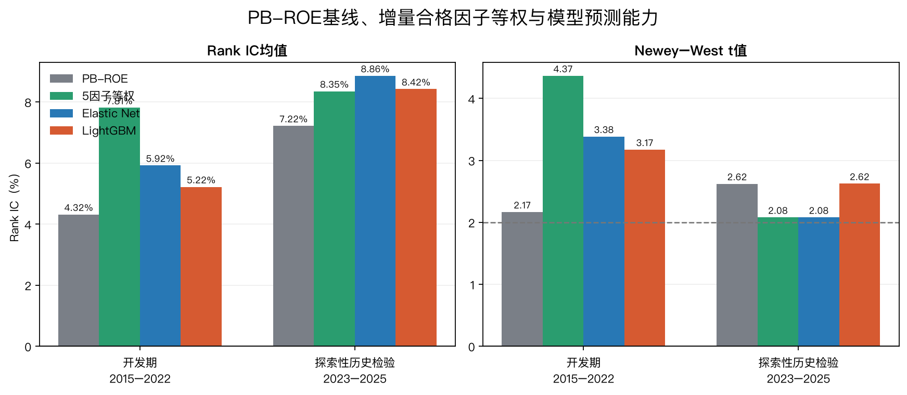
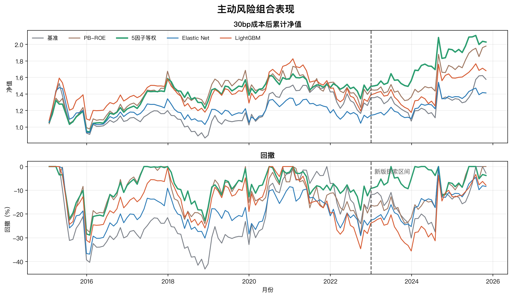
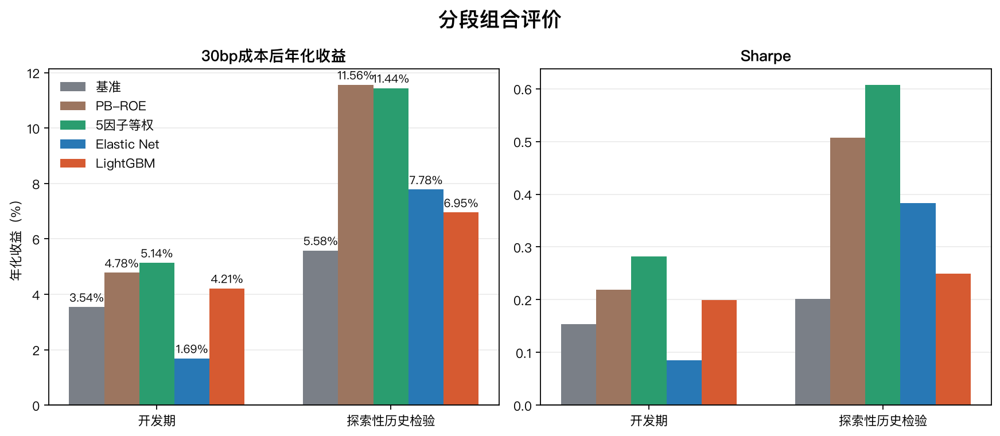

# PB-ROE基线、5因子模型与组合优化报告

## 1. 目标与比较顺序

```text
现代PB-ROE基线
  → 8个独立候选做诊断
  → 6个扩展候选做PB-ROE增量检验
  → 通过资格的BP、ROE、动量、反转、低波形成5因子方向等权
  → Elastic Net检验动态线性权重
  → LightGBM检验非线性和交互
  → 四条主信号进入同一组合优化器
```

这依次回答：扩展因子是否改善PB-ROE；模型学习是否优于简单等权；排序优势能否转成成本后的长仓组合。严格1个月反转另作旁证，不替代PB-ROE主基线。

## 2. 统一输入、目标与walk-forward

两模型读取同一5因子manifest：BP、ROE、12–1月动量、1个月反转、低60日波动。PB-ROE是比较基线，不重复输入；EP、OCF/P、营收增长未通过Add-one增量门槛。

每个预测月T执行：

```text
T以前的历史信号
  → 只保留退出日不晚于T的成熟收益标签
  → 最多最近60个成熟月，至少24个月
  → 将每个月下一期收益转为截面百分位排名并中心化
  → Elastic Net：完整成熟窗拟合
  → LightGBM：前48个月拟合、后12个成熟月按时间验证并早停
  → 预测T月横截面，下一交易日开盘执行
```

训练目标与最终Rank IC一致；组合绩效仍使用真实可交易收益。没有随机切分或大规模调参。2015–2022用于开发；2023–2025已经被查看，因此本轮重构结果只能称探索性历史检验。

## 3. 信号预测能力

| 方法 | 开发IC | 开发NW t | 2023–2025 IC | 2023–2025 NW t | 结果 |
|---|---:|---:|---:|---:|---|
| PB-ROE基线 | 4.32% | 2.17 | 7.22% | 2.62 | 基线仍有排序信息 |
| 5因子方向等权 | **7.81%** | **4.37** | 8.35% | 2.08 | 简单、稳定 |
| Elastic Net | 5.92% | 3.38 | **8.86%** | 2.08 | 探索期Rank IC最高 |
| LightGBM | 5.22% | 3.17 | 8.42% | **2.62** | 未超过线性模型 |



训练目标修正后，两个模型的探索IC不再明显落后。Elastic Net略高于简单等权，说明线性收缩具有一定排序增量；LightGBM仍未超过Elastic Net，非线性增量没有成立。下一层必须检查更高IC能否转为组合收益。

## 4. 统一组合构建

四条主信号使用同一基准相对长仓优化器：满仓、非负、单票≤3%；风险矩阵只用信号日前历史收益；相对漂移后旧持仓的可自主月换手≤30%；成分强制退出或单票上限修复造成数学不可行时，只把当月上限扩展到不可避免下限；交易成本仍按全部实际换手收取。测试10/30/50bp成本。因缺少PIT行业分类，不启用历史行业约束；基准为沪深300历史成分等权代理。

## 5. 2023–2025探索性组合结果

| 30bp成本后 | 年化收益 | Sharpe | 最大回撤 | 信息比率 | 月均换手 |
|---|---:|---:|---:|---:|---:|
| 沪深300成分等权代理 | 5.58% | 0.20 | -21.51% | — | — |
| PB-ROE基线 | **11.56%** | 0.51 | -12.83% | **0.32** | 11.80% |
| 5因子方向等权 | 11.44% | **0.61** | **-12.14%** | 0.23 | 28.60% |
| Elastic Net | 7.78% | 0.38 | -12.99% | 0.05 | 29.81% |
| LightGBM | 6.95% | 0.25 | -19.13% | 0.15 | 30.00% |



5因子等权没有在绝对年化上超过PB-ROE，差0.12个百分点；但Sharpe更高、最大回撤略小，是风险调整后表现最好的方案。Elastic Net虽然Rank IC最高，组合年化只为7.78%；LightGBM为6.95%。排序、持仓约束、信号幅度和换手共同造成“IC提高但收益未同步提高”。严格反转旁证仍失败：30bp后年化-4.84%、Sharpe -0.13。

## 6. 成本敏感性

| 方法 | 10bp年化 | 30bp年化 | 50bp年化 |
|---|---:|---:|---:|
| PB-ROE | 11.87% | 11.56% | 11.25% |
| 5因子等权 | 12.20% | 11.44% | 10.69% |
| Elastic Net | 8.55% | 7.78% | 7.01% |
| LightGBM | 7.72% | 6.95% | 6.19% |



简单等权对成本比PB-ROE更敏感，因为月均换手更高。50bp下PB-ROE重新取得明显年化优势。这里仍是线性成本敏感性，未完整模拟冲击成本、排队成交和大额容量。

## 7. 结论

1. 3个扩展因子通过开发期增量检验，5因子等权的Rank IC高于PB-ROE。
2. 5因子等权改善Sharpe与回撤，但没有提高30bp后的绝对年化；它是风险调整champion，不是无条件收益champion。
3. Elastic Net提供小幅探索期Rank IC增量，但没有转化为组合增量。
4. LightGBM未超过Elastic Net，也未超过简单等权，保留为可证伪challenger即可。
5. 下一步应冻结当前manifest、目标与成本口径，等待新增月份前瞻验证，不做结果驱动调参。
